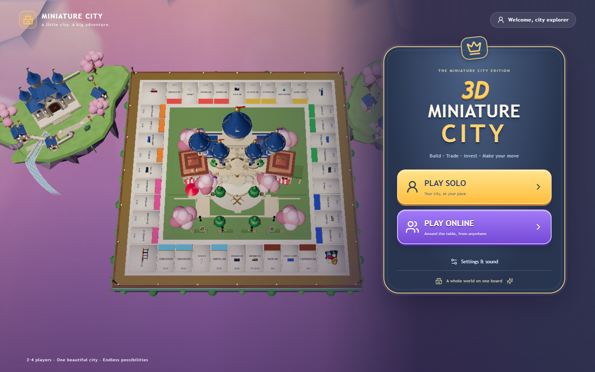
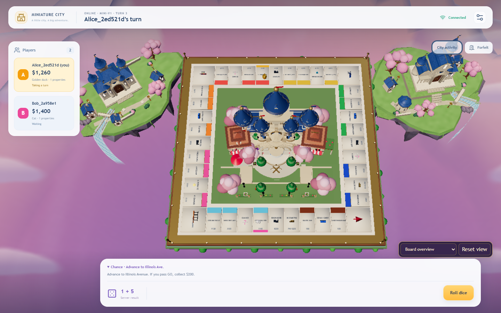
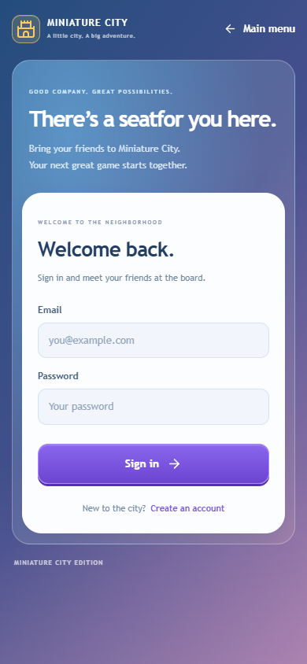
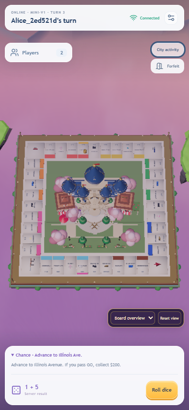
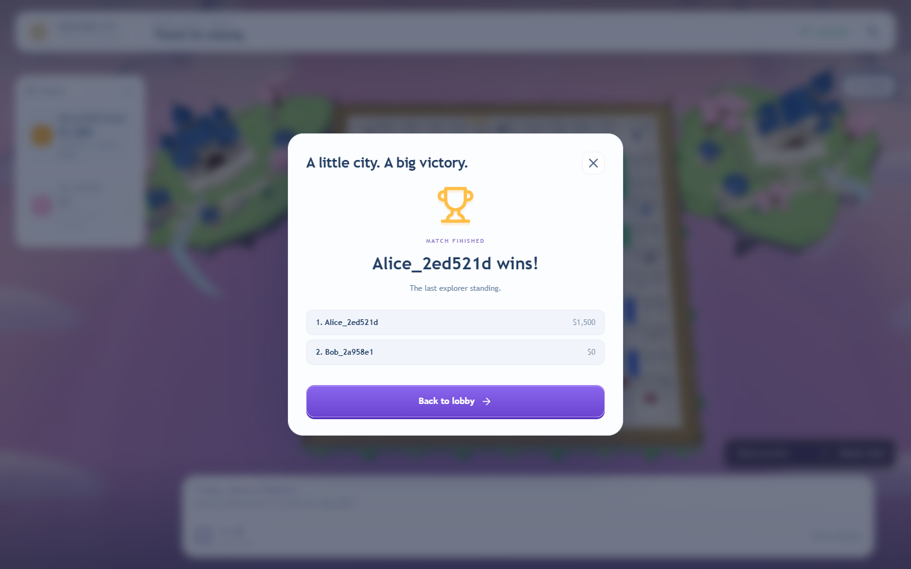

# Multiplayer frontend verification — 13 November 2026

## Executed checks

| Check | Actual outcome |
|---|---|
| Frontend production build (`npm run build`) | Passed; Vite reports its existing large-bundle warning (about 1.65 MB minified / 470 KB gzip for the combined app). |
| Frontend online tests (`npm run test:online`) | **16 passed**, 0 failed. |
| Existing animation, camera and environment asset tests | **37 passed**, 0 failed. |
| Backend rules engine (`npm test` in backend) | **57 passed**, including 500 complete randomized engine games. |
| Backend TypeScript check and production build | Passed. |
| Backend HTTP/Socket.IO/PostgreSQL integration | **4 passed**, including restored standings and last-socket presence across multiple tabs. |
| Real frontend browser suite (`node scripts/online-browser.mjs`) | **10 scenarios passed**, no uncaught page errors. |
| Existing real 3D browser regression (`scripts/graphics-regression.mjs`) | Passed: all 40 tiles visible and pickable at 1440×900, 1366×768, 768×1024 and 390×844; touch picking, all camera presets, orbit/zoom, Solo dice/movement/purchase/end-turn; no uncaught errors. |
| Lockfile install check (`npm ci --dry-run --ignore-scripts`) | Passed. Reports the pre-existing postprocessing/Three peer-version warning. |
| `git diff --check` | Passed. |

The browser run used isolated Chrome contexts for Alice and Bob, the actual Vite UI at `http://localhost:5174`, NestJS at local port 3000, and a dedicated PostgreSQL 16 Docker database at port 55432. No production data was used. The database was migrated with the committed Prisma migration. The disconnect grace was set to two seconds for the test. Captures use the existing low graphics quality to keep the concurrent browser run inexpensive; the application retains all three graphics settings.

The definitive sanitized browser receipt is [evidence/results.json](./online-frontend/evidence/results.json). The script remains in the repository and supports environment overrides documented in [ONLINE-FRONTEND.md](./ONLINE-FRONTEND.md).

The presence integration test reuses accounts created through real HTTP earlier in the suite. This keeps CI's preceding smoke test plus integration tests within the unchanged ten-registrations-per-minute limit. Running that test alone still creates fresh accounts through the API.

## Browser scenarios

- **A — Solo:** actual local roll, movement to a property, purchase, turn handoff and AI movement. Only this Solo RNG was fixed for reproducibility; all online dice remained backend-generated.
- **B — Authentication:** register, logout, login, browser reload, CSRF/cookie restoration; HttpOnly/Lax cookie attributes checked and no credential keys in browser storage.
- **C — Public room:** discover the real host-created room, join from the second context, observe live membership/readiness, host start, enter the same match and existing 3D scene.
- **D — Private room:** absent from public results, wrong invite rejected, old invite rejected after rotation, new invite accepted through the UI.
- **E — Online gameplay:** both clients render identical committed dice, positions, balances and ownership; UUID-to-seat mapping is checked against the actual 3D presentation store, followed by turn handoff.
- **F — Reload:** cookie session restores and the original match is rejoined without issuing a duplicate action.
- **G — Disconnect:** closing the participant page closes its real socket; the server pauses after grace; reopening restores the cookie/session, rejoins and resumes the same turn.
- **H — Idempotency:** an exact replay of the original roll request returns the original action ID/version without a second roll.
- **I — Finish:** voluntary forfeiture triggers the supported last-player terminal condition; both clients display the server result; authoritative rankings survive a page reload.
- **Multiple tabs:** concurrent CSRF restoration in a match tab and lobby tab preserves account identity and match presence. The backend integration suite separately verifies two actual match sockets for one account, with disconnect only after the last one closes.

## Review captures

| Menu | Online board |
|---|---|
|  |  |

| Mobile authentication | Mobile match | Results |
|---|---|---|
|  |  |  |

## Findings fixed during verification

- Browser fetch requires a valid invocation receiver; the API client now calls its injected transport as a function rather than as an instance method.
- A lost Socket.IO subscription acknowledgement previously left a connected socket permanently waiting. The manager retries its subscription through a reconnect.
- An animation assertion must wait for the committed presentation transition; older visual frames cannot overwrite a newer snapshot. Cancellation has a focused regression test.
- Form-switch focus now runs in a layout effect, avoiding a delayed focus change while entering another field.
- Late room responses cannot repopulate or redirect a disposed screen.
- The backend previously omitted persisted standings from snapshots. Results recovery is now supported and integration-tested.
- The existing environment model cleanup called `instance.dispose()` even though R3F's `dispose={null}` masks that method. Cleanup now invokes Three's prototype method to release only instance buffers, preserving cached GLB geometry and atlases. The regression test checks both resource lifetime boundaries.

## Practical limits

Public hosting is not configured or tested. The checked-in deployment workflow serves the static frontend on GitHub Pages only; there is no configured production NestJS/PostgreSQL endpoint. Persistent authentication across GitHub Pages and an unrelated API domain is **not verified** and is incompatible with assuming cross-site Lax cookies will work. Use the documented same-origin HTTPS reverse-proxy design and test production origins before release.

The browser suite tests Chrome desktop and mobile viewport layouts, not physical iOS/Android devices. It does not wait through a literal 15-minute JWT lifetime, a 24-hour all-offline expiry, or restart the backend during a running browser match. Proactive refresh, socket reauthentication, out-of-order/duplicate notifications, stale versions, uncertain action retries and cancellation have automated unit coverage. Full 80-turn completion, Jail and every card rule are exercised in the backend rules suite; the browser terminal test uses voluntary forfeit. This is mini-v1, with advanced auctions/trading/buildings retained in Solo only.

Early integration attempts exposed the issues listed above. Running auth-heavy browser and API suites concurrently also reached the server's real registration rate limit; final suites were run separately without weakening that limit. Intentional negative tests produce 401/409 responses. Room departure can race a now-unauthorized fallback read; disposal prevents that read from updating the departed screen. A `THREE.WebGLRenderer: Context Lost` console notification on Canvas teardown is expected; the final browser run records **zero uncaught errors**.
