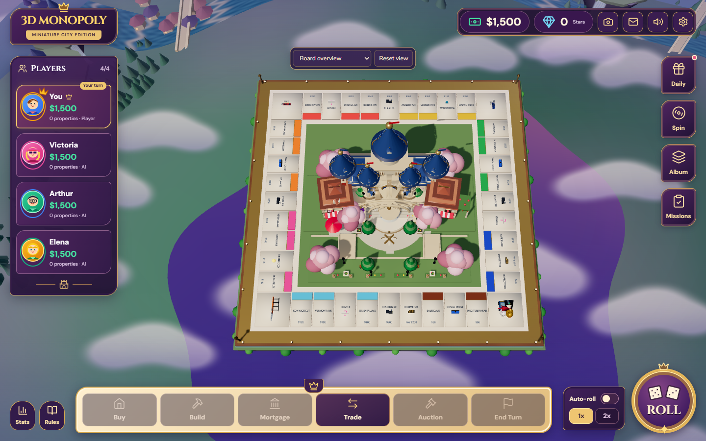
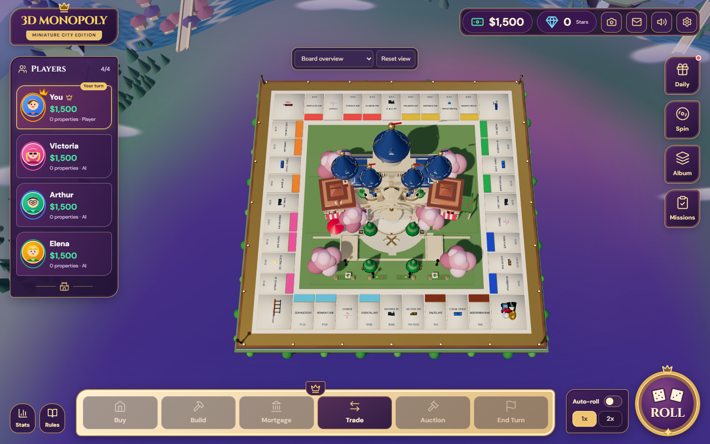
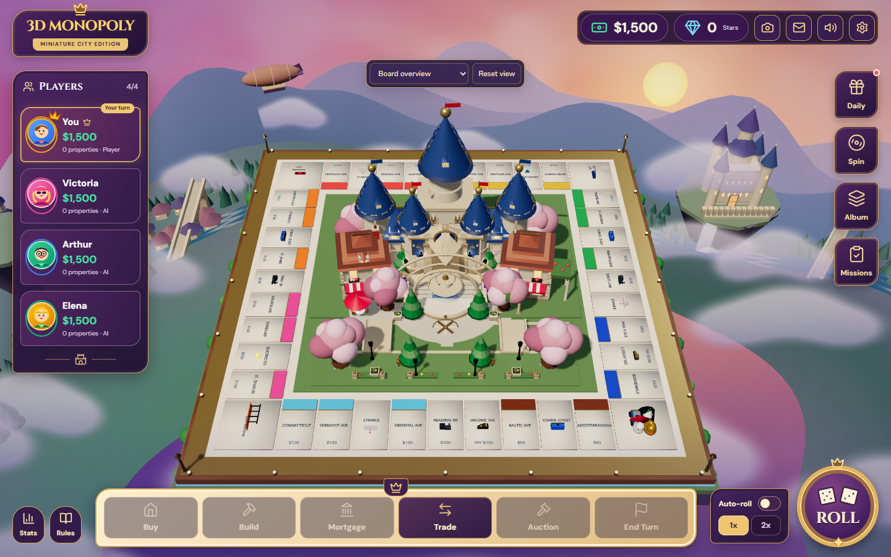
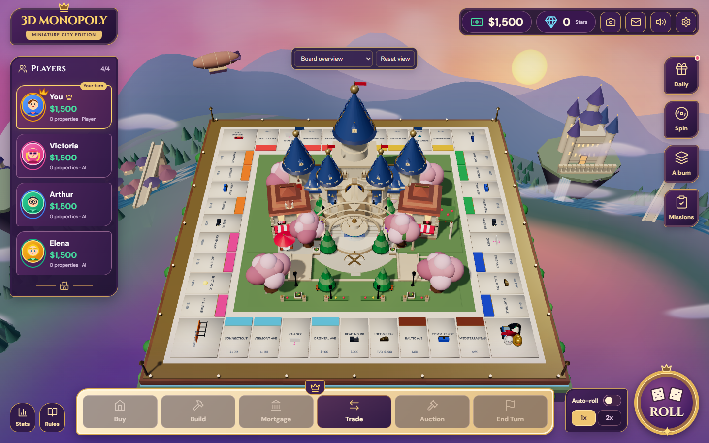

# Floating board — open-air environment composition

## Cause

The problem came from the environment layout, rather than the board or castle. Layer-isolation captures identified two contributors:

1. `DistantLandscape` built a complete annulus starting only **25–35 world units** from the origin. Its height fell outward at `0.54 × radius`, with vertical waves of up to 7 + 3 units. The raised inner rim ended at a hard, irregular edge. In the overview, the purple sky exposed by that cutout read as a large swollen mass, especially at the lower right. Hiding the valley removes that outline; hiding clouds alone does not.
2. `FloatingClouds` placed twelve nearby billboards at radius **24–34**, Y **−10 to −13**, with heights **7–8**. Five additional overlapping **20×10** billboards at Y **−13** deliberately filled the space directly below the board. These formed a visual cushion rather than open air.

[Valley hidden](evidence/before/without-kingdom-valley.png) · [Clouds hidden](evidence/before/without-kingdom-cloud-layers.png)

## Focused fix

- Open the foreground cutout outward by up to **38 units**. Lower the nearby foreground apron by up to **20 units**, reducing its two height-wave amplitudes by **65% / 60%**. The rear height profile is unchanged.
- Fade the inner terrain edge over **28 world units** using vertex alpha, so the circular rim no longer creates a hard arched outline. Render only the ground's top faces; its underside otherwise produces a dark curved lip at lower camera angles. This uses the existing mesh and one material pass, with no texture, fog, blur or post-processing effect added.
- Move the near clouds to radius **44–76**, Y **−26 to −40**, and reduce their height to **3–4.2**. Thin the distant layers to **4.5–7** units. Remove the five central filler billboards entirely. Retain the existing cloud shader, palette, drift, quality budgets and distant waterfall mist.
- Keep trees and cottages off the fading inner rim, so they remain supported by visible distant terrain. Floating castle islands retain their own existing rock bases.

The board, castle, HUD, lights, camera framing, controls, sky shader, sun, distant mountain component and gameplay code are unchanged. The board keeps the same screen position and size, with much more quiet space below it.

## Before / after

Both captures use 1440×900, balanced quality, device scale 1, seed 10425058 and reduced motion. The overview camera, target, FOV and projection offset are identical before and after; exact values are saved in the capture JSON. A second pair uses camera `[0,32,30]`, target `[0,0.5,0]`, FOV 40, without a projection offset.

| Camera | Before | After |
|---|---|---|
| Current overview |  |  |
| Three-quarter |  |  |

## Files

Production composition changes:

- `src/components/environment/environmentLayout.ts`: foreground height, opening/fade helpers, deterministic cloud placement.
- `src/components/environment/DistantLandscape.tsx`: use the opening and fade, top-facing terrain, retain trees on visible terrain.
- `src/components/environment/FloatingClouds.tsx`: consume the shared cloud layout; remove direct underside filling.
- `src/components/environment/FantasyKingdom.tsx`: keep cottages on visible terrain.

Supporting changes: `tests/environment.test.mjs` adds three layout regressions; the opt-in `GraphicsAudit` probe can hide environment layers for diagnosis; `scripts/environment-composition.mjs` reproduces the matched captures; the existing browser regression accepts a separate output directory to preserve Phase 1 evidence.

## Validation

Production build and TypeScript lint pass. All **37 unit tests** pass, including the existing gameplay presentation/environment/camera tests and new checks for lower foreground terrain, an unchanged rear profile, a continuous terrain fade and cloud clearance in every quality mode. Browser regression passes all forty spaces at four viewports (including touch), every camera preset, orbit/zoom/reset and a real roll/purchase/end-turn sequence with no page errors. Results are retained separately in [results.json](evidence/regression/results.json).

On Radeon 610M / Chrome 156, the same five-second balanced overview sample recorded **2,682 → 2,682 draw calls**, **216,293 → 213,202 submitted triangles**, and **3 → 3 textures**. Throughput was **37.7 → 40.2 FPS**, with median GPU time **24.9 → 23.6 ms**. These short, reduced-motion samples are a cost check, not a general frame-rate guarantee. No geometry subdivisions, shadow passes, libraries or render targets were added.

To reproduce: build and preview on port 4175, then run `node scripts/environment-composition.mjs before --diagnose` on base `7a0bd68`, and `node scripts/environment-composition.mjs after` on the fix. The base needs only the same opt-in audit layer toggle and capture script copied in. `CHROME_PATH` and `AUDIT_URL` override the local Chrome path/preview address. `node scripts/check-environment-evidence.mjs` checks exact camera/tile projection parity and the rendering budgets, and generates [image hashes](evidence/sha256.json). In PowerShell, save browser checks separately with:

```powershell
$env:GRAPHICS_REGRESSION_OUT='docs/environment-composition/evidence/regression'
node scripts/graphics-regression.mjs
```
