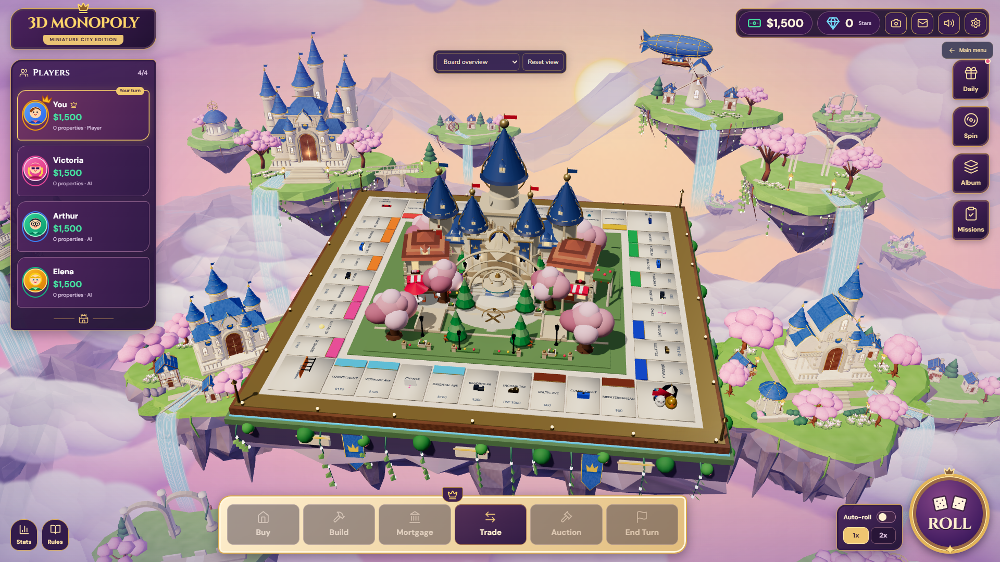
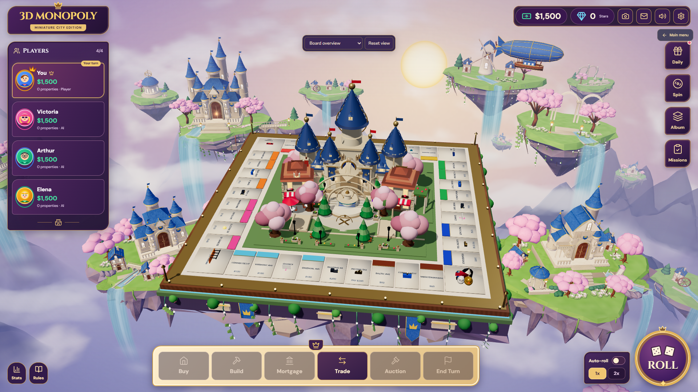
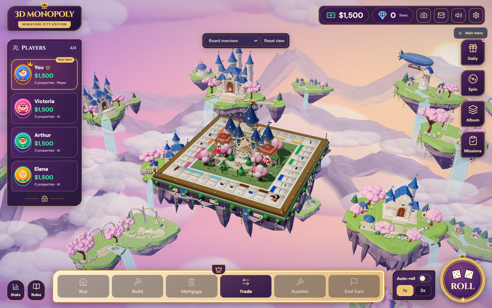
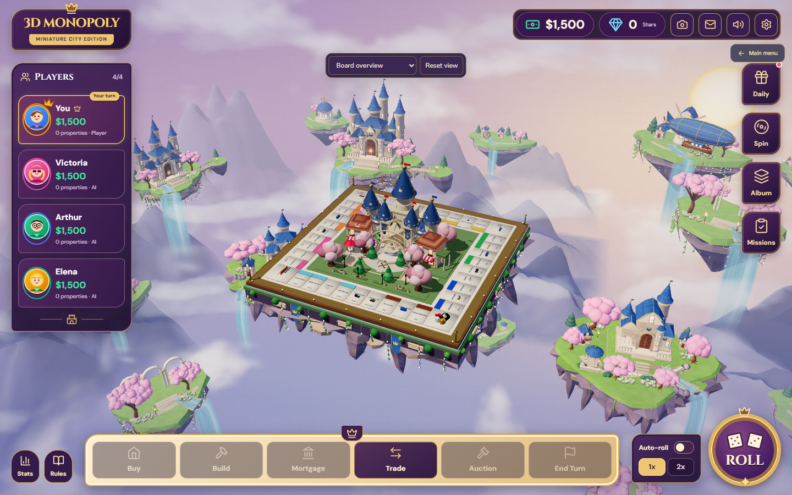

# Environment visual polish V2

This environment-only pass starts from main at `842217f` (merged PR #52).
The supplied fantasy concept guides the royal-blue roofs, ivory stone,
blossom gardens, floating cliffs and sunset atmosphere. All destinations
remain world-space 3D objects. No reference pixels are used as a background.

## Visual changes

The previous clouds exposed repeated spherical lobes, waterfalls read as
parallel threads, and mountain ribbons formed folded triangular walls.
Some camera directions lost nearby landmarks behind the board. Two pairs
of existing islands also overlapped in world space.

- Redistributed the existing observatory and ruins into sparse rear
  quadrants, separated the overlapping villages, lowered and slightly
  reduced the distant citadel, and moved the airship away from the top HUD.
  The number of distinct landmarks remains **22**.
- Replaced sphere-derived cloud masks with eight irregular 3D fractal-density
  volumes baked offline. Straight-alpha masks include optical-depth self
  shading and transparent gutters. Horizon, middle, lower and limited upper
  banks share one instanced pass, sorted by depth only when the camera moves.
  Low/Medium/High use 24/32/40 cards and preserve the same first 24 placements.
- Rebuilt the sky bake with a continuous density field, restrained peach
  sunlight, cool upper accents, lavender haze and a diffuse lower cloud sea.
  The sky bakes once per quality/context. No per-frame volume raymarch or
  full-screen noise pass is added.
- Refined the original hero islands, citadel and board foundation in Blender:
  shorter divided undercuts, embedded eroded ledges, asymmetrical cliff
  outlines, recalculated normals and rebaked cavity shading. Existing roof
  modules, windows, entrances, paths, bridges, flags, roots, foliage and water
  anchors are retained. Hidden rock/leaf/wood microgeometry is simplified.
- Waterfalls now open into broad convex sheets with layered ripples, sparse
  highlights, white source foam, softer edges and gently moving base mist.
  Each of the 15 water groups retains two draws. No fluid simulation is used.
- Replaced mountain ribbons with 30 independent multi-peak heightfields at
  four depths. Asymmetric summits, valleys, front/back slopes, smooth normals,
  directional vertex tint and feathered edge haze replace the folded wall.
  All massifs share one draw and cast no shadows.
- Unified roughness-dependent highlights and aerial haze in the existing
  environment shader. The playable board retains its original lighting.

## Camera audit

The gameplay camera source remains unchanged:

| Setting | Existing behavior retained |
| --- | --- |
| Initial Canvas position | [0,29,27] |
| FOV / target | 40° / [0,0.7,0] |
| Azimuth / panning | Unrestricted / disabled |
| Polar limits | 0.04…π/2.65 |
| Distance limits | 16…max(85, responsive fit distance × 1.3) |
| Board footprint used for fitting | ±13m including foliage and plinth |
| Default overview | Fits board and narrower castle inside responsive HUD insets |
| Close / wide capture positions | [4.5,27,40] / [28,45,60] |

The settled overview differs from the initial Canvas pose because the existing
responsive fitter runs after mounting. The source screenshots lack original
camera metadata, so the close/wide poses reconstruct those viewpoints without
claiming an exact historical pose match. Before/after poses, responsive
offsets, viewports and DPR are checked for equality.

[The coverage analyzer](../../scripts/environment-v2-coverage.mjs) projects
actual exported bounds through 32 poses: eight azimuths, two elevations
(0.55/1.18 radians), two distances (50/80m). It subtracts the HUD rectangle,
board AABB and narrower central-castle AABB. This is a conservative framing
proxy, not a measurement of visible building pixels or proof for every
continuous camera position. Browser captures and actual tile rays complement it.

| Coverage proxy | Before | After |
| --- | ---: | ---: |
| Distinct landmark placements | 22 | 22 |
| Audited poses | 32 | 32 |
| Minimum readable landmark bounds | 1 | 2 |
| Median readable landmark bounds | 6 | 6 |
| Poses with scenery only on one side | 3 | 0 |

Final exported landmark AABBs have **zero intersections at all three asset
tiers**, and stay below and outside the gameplay column. The foundation
deliberately sits below the board. See [before coverage](evidence/before/coverage.json),
[after coverage](evidence/after/coverage.json) and the
[world-space plan](evidence/after/world-layout.svg).

The only camera-related change is in the environment atmosphere component:
the far plane becomes max(400, camera distance + 300), formerly +220. The
broader massifs reach about 285m from the origin and otherwise disappear when
the existing responsive camera pulls away. This does not alter camera pose,
FOV, target, zoom limits, damping or controls.

## Production screenshots

Thirteen before/after pairs were captured and visually reviewed in real Chrome:
close and wide views in Medium/High, default overview in Medium/High, east,
reverse, west, previously sparse 135°/225° views and two phone orientations.
Medium is the project's `balanced` preset. All 40 tile rays remain clear of
scenery in every capture, with no fallbacks or console/page errors.

| Close / High before | Close / High after |
| --- | --- |
|  |  |

| Wide / High before | Wide / High after |
| --- | --- |
|  |  |

[All 13 paired views](SCREENSHOTS.md) · [Exact capture metadata](evidence/after/views.json).

The central castle, Monopoly tiles, HUD, menu, action dock, roll control,
gameplay rules, dice, movement, AI, authentication, sockets and backend retain
their source. Background assets disable raycasting and add no shadow casters.

## Blender production and asset costs

Installed **Blender 5.2.3 LTS** executed
[polish_environment_v2.py](../../tools/blender/polish_environment_v2.py) and
[bake_clouds_v2.py](../../tools/blender/bake_clouds_v2.py). The former imports
and refines original project GLBs through `bpy`, retaining architecture and
effect anchors. The latter uses Blender's bundled NumPy for offline volume
integration and six optical-depth lighting taps. Blender/Python are never
required by the deployed website.

| Refined GLB | High triangles | Medium | Low |
| --- | ---: | ---: | ---: |
| Left castle island | 35,709 | 22,676 | 12,421 |
| Right palace island | 29,335 | 19,539 | 10,786 |
| Distant citadel | 37,706 | 22,892 | 12,516 |
| Board foundation | 6,264 | 4,018 | 2,426 |

Every refined variant has fewer triangles than its original. All 12 contain
applied metre-scale Y-up geometry, baked cavity vertex colours, the original
embedded 128² atlas, retained water anchors and original-file SHA256 receipts.
Original GLBs remain byte-for-byte unchanged. Distant placements keep the
original cheaper distant LODs. More detailed vertex data and ledges increase
selected GLB download from 4.8→5.3 MiB Low, 7.8→8.5 MiB Medium, 11.8→13 MiB High.

Eight cloud variants fit one selected PNG: 512×160 Low (57.1 KiB), 896×256
Medium (141.9 KiB), 1280×384 High (256.4 KiB). Actual decoded alpha coverage,
soft transitions, distinct silhouettes, transparent cell gutters, dimensions
and byte hashes pass the atlas validator.

[Refined receipts](../../public/assets/models/environment/polish-v2-manifest.json) ·
[Actual binary validation](evidence/asset-validation.json) ·
[Cloud receipts](../../public/assets/textures/environment/cloud-volume-v2-manifest.json) ·
[Cloud validation](evidence/cloud-validation.json) ·
[Reproduction instructions](../../tools/blender/README.md).

All assets are original project work under the repository MIT license. No
paid generation provider was used. The optional game-dev CLI is absent; the
repository binary validators and actual browser were used.

## Measured rendering cost

On Chrome 157 / Three r164 / AMD Radeon 610M Direct3D11, equivalent 1440×900
poses show lower median GPU time in all nine samples. These measurements use
four-second warmup, five-second samples, seeded gameplay, reduced motion and
the same DPR per tier, with no second GPU workload.

| Tier | Overview FPS before → after | Close FPS | Wide FPS |
| --- | ---: | ---: | ---: |
| Low | 71.4 → 89.9 | 73.1 → 95.2 | 71.7 → 93.8 |
| Medium | 46.1 → 50.5 | 50.1 → 54.5 | 51.9 → 56.7 |
| High | 42.0 → 45.2 | 46.2 → 49.7 | 42.3 → 52.5 |

The fuller mountain surfaces add geometry, while refined assets and fewer
cloud cards offset some cost. Draw counts are essentially unchanged. High
close-view texture allocation estimates rise 6.9→8.1 MiB; geometry buffers
are 19.0→18.9 MiB. These are scene allocation estimates, not driver VRAM.
Local FPS includes CPU scheduling and is not a performance promise for other
devices. [Full p50/p95, GPU, draw, triangle, memory, download and readiness
tables](PERFORMANCE.md) include raw evidence and measurement limits.

## Verification

- Production TypeScript/Vite build. Local host: Node 24.21.0 with the existing
  Rollup WASM shim; project CI uses Node 22.
- 46 presentation, camera, layout, menu-boundary and atmosphere tests;
  16 online state/lifecycle tests; 12 actual asset/PNG/malformed-asset tests.
- [Mouse/touch gameplay regression](evidence/regression/results.json): all
  40 spaces across four viewport sizes; presets, top/reset/orbit/zoom;
  authoritative dice [1,2], movement to Baltic Avenue, $60 purchase, end turn.
- [Motion regression](evidence/regression/environment-motion.json): live
  reduced motion and hidden-tab freeze; ordinary play has no audit globals.
- [Resilience](evidence/regression/resilience.json): four mounts with stable
  allocations and one download per cached asset; aborted GLB and cloud PNG
  preserve tile selection; GLB/PNG subdirectory deployment checked.
- [Context restoration](evidence/regression/context-restore.json): all three
  quality tiers recover with byte-identical restored sky pixels.

The unchanged backend's full PostgreSQL/two-player browser suite runs in the
existing PR workflow; local online state tests also passed.

## Limits

The concept's painterly flowers, detailed foliage and cinematic lighting are
approximated with bounded browser geometry and baked shading. Clouds use soft
view-facing impostors and a continuous sky bake, rather than a runtime
volumetric simulation. Existing castle and village architecture is retained
and refined through shading/supporting terrain rather than replaced wholesale.
Individual landmarks can still pass behind the HUD during unrestricted orbit.
At the existing 844×390 landscape layout, the HUD occupies most of the screen
and the responsive board becomes small; that pre-existing UI/camera behavior
is preserved. The 32-pose proxy and 13 captures do not prove every continuous
camera position. No identical render of the concept is claimed.

## Reproduce

Build/serve unchanged main at `842217f` on 4183 and the candidate on 4184.
Keep the existing `before` evidence; never recapture it from candidate sources.
The original layout snapshot is saved in `before/coverage.json`.

```sh
npm run test:environment-assets
npm run build
node scripts/environment-v2-review.mjs after
node scripts/environment-v2-coverage.mjs after
# AUDIT_URL=http://127.0.0.1:4184
# AUDIT_EVIDENCE_ROOT=docs/environment-visual-polish-v2/evidence
# AUDIT_CAMERAS=overview,reference,wide
node scripts/atmosphere-audit.mjs after
node scripts/environment-v2-report.mjs
```

See [Blender authoring instructions](../../tools/blender/README.md) for actual
generation commands and selective asset regeneration. Browser scripts use
the installed Chrome; override `CHROME_PATH` if needed.
