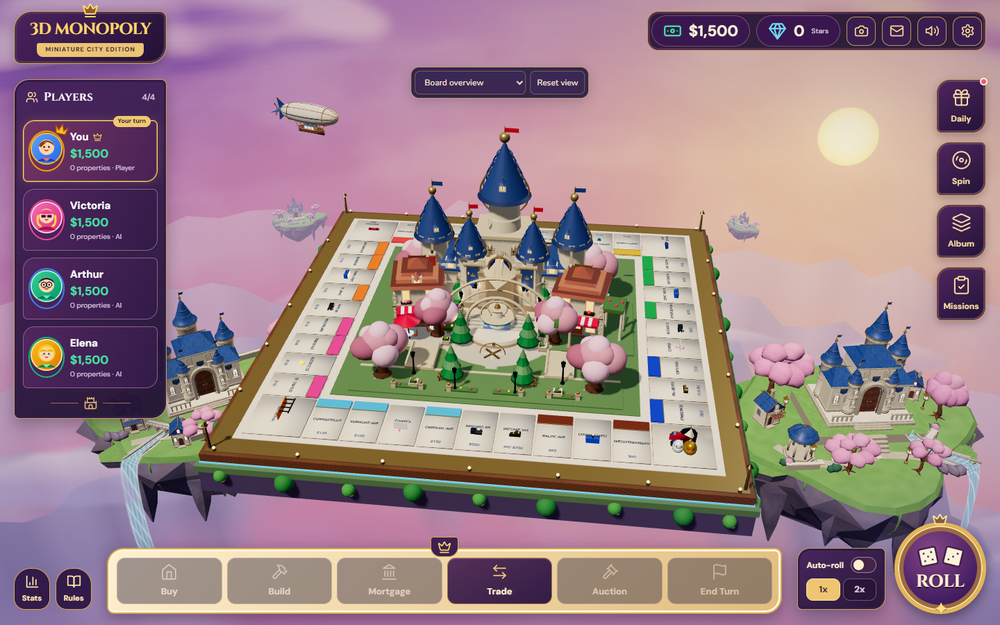
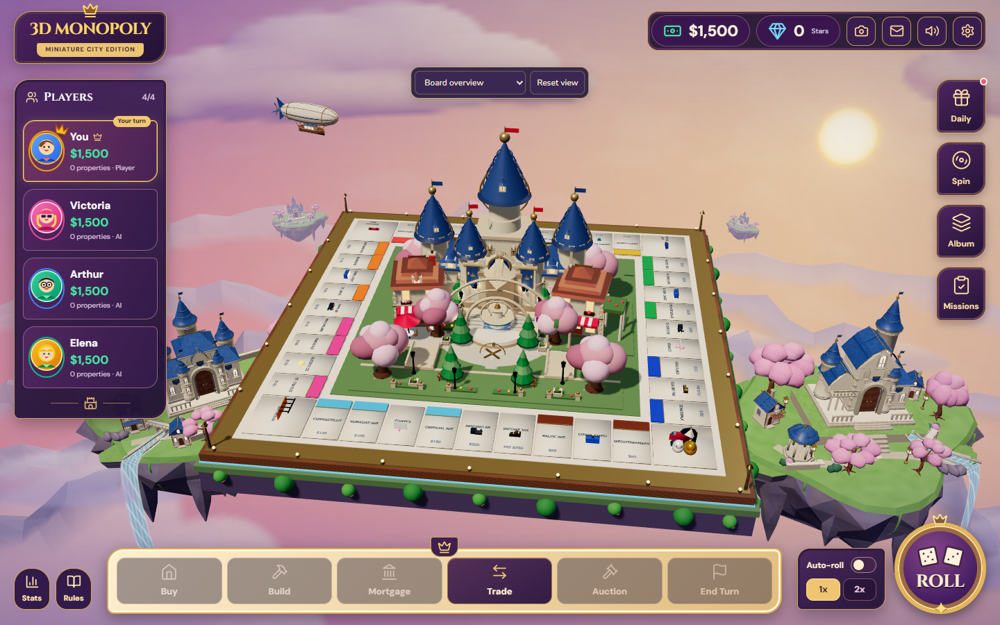
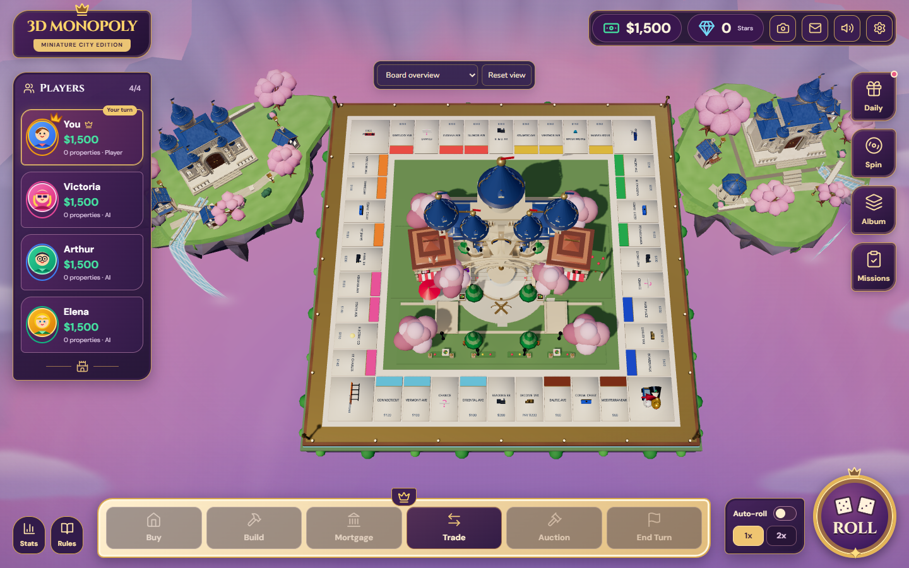
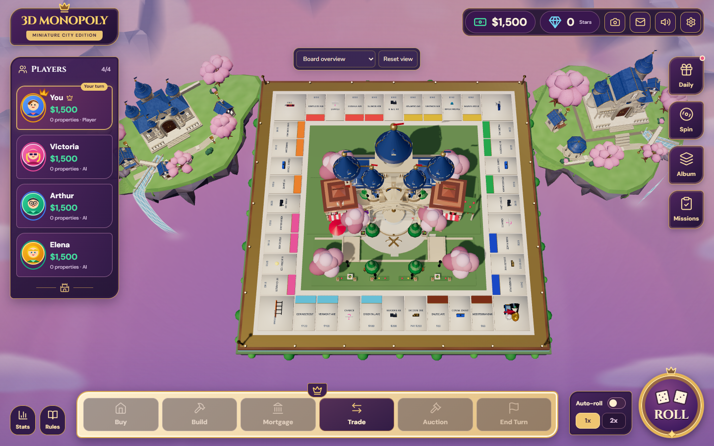

# Premium fantasy kingdom continuation

This pass builds on the supplied current scene at `2c3b62d`, in the requested `.phase1-worktree` and `graphics/fantasy-atmosphere-polish` branch. The mandatory Blender → GLB → useGLTF pipeline is retained. Existing completed island, vegetation, bridge, garden and airship work is reused.

## What changed

The background kingdoms now have different architecture, rather than the same five-tower building with small offsets. The left retains a five-spire gatehouse with a swept heraldic pediment. The right becomes a three-tower palace with a steep vaulted nave, glazed gable, gilded roof verges and an open three-bay loggia/balcony. These are actual bpy meshes exported into the two island GLBs. Fewer duplicated towers reduce right-island triangles while the new gallery and roof silhouettes establish its identity.

The sky now shades rounded cloud lobes with cream/peach caps and lavender undersides. Large initial banks were reduced after browser review. The sun has a warm limb and halo. Broad cloud shading, the sun halo and display colour conversion are baked once; the gameplay sky samples the finished texture. One small analytic solar patch keeps the disc crisp at screen resolution, adding one draw and two triangles when visible. It draws before gameplay geometry and adds no light. The bake regenerates after real WebGL context loss. No real-time volume march or heavy bloom is used.

The four distant mountain layers now contain crest and flank surfaces with directionally shaded facets. They remain separate from the board column. Quality-dependent row/segment counts bound their geometry. Existing anchored river/waterfall animation, mist, cloud motion, airship, villages, sakura and garden storytelling remain integrated.

The board, central castle, projected framing, FOV, camera/controller, HUD, tokens, dice, gameplay/store, backend and API contracts are unchanged. Global exposure/lights/shadow budgets are preserved. The original dirty main checkout and the baseline worktree are not modified.

## Same-camera comparison

The overview is the existing production preset. The reference view is `[4.5,27,40] → [0,.7,0]` at 1440×900, a representative lower angle resembling the supplied screenshot. Its exact original camera metadata was unavailable. Before/after pairs assert identical camera, viewport and render DPR; the board was not made smaller.

| Before | After |
| --- | --- |
|  |  |
|  |  |

[High view](evidence/controlled-release/after-high-reference.png) · [Low view](evidence/controlled-release/after-low-reference.png) · [Phone](evidence/regression/overview-390x844.png) · [Top view](evidence/regression/top-view.png).

## Verification

Build, 47 tests and inspection of all 22 actual GLBs pass. All quality modes load the expected exported bytes with no failed requests or browser rendering errors. The camera audit checks every property against real environment geometry. Mouse/touch regression covers all 40 tiles at four viewport sizes, top view, focus presets, reset/orbit/zoom and a real roll–move–purchase–end-turn sequence. Motion checks exercise live reduced-motion and document visibility preferences. Real context-loss/recovery checks pass all three qualities with a pixel-identical static sky region.

A matched static tile strip contains [14,700 identical pixels](evidence/static-tile-strip.json). This is evidence for that opaque region; legacy elapsed-time animations mean the entire city capture is not claimed pixel-identical.

[Performance and exact asset inventory](performance.md) includes both A/B and B/A run orders, GPU timers, draw calls, triangles and texture allocation indicators. Earlier adverse/noisy measurements remain available. These measurements do not imply universal 60 FPS or concept-image equivalence.

## Regenerate and resume

```sh
blender --background --factory-startup --python-exit-code 1 --python tools/blender/generate_environment.py -- --milestone final --only royal-island-left,royal-island-right
python tools/blender/validate_assets.py --manifest public/assets/models/environment/manifest.json
npm run build
node --test tests/*.test.mjs
```

The unchanged foundation/standalone props need no regeneration. Full authoring/coordinate conventions are in [the Blender guide](../../tools/blender/README.md). Reproducible A/B tools extract the starting source into ignored `.audit-master-baseline` inside this feature worktree, without switching/resetting another worktree or installing dependencies. Supply `CHROME_PATH` where the default Windows Chrome path differs.

[FANTASY_ENVIRONMENT_PROGRESS.md](../FANTASY_ENVIRONMENT_PROGRESS.md) records milestone state and continuation steps. Read it before resuming; do not restart completed exports.

## Changed files and limits

- `generate_castles.py`, eight kingdom GLBs and `manifest.json`: distinct roofs, tower configurations, portal and gallery modules.
- `FantasySky.tsx`, new `skyCloudBake.ts`, `DistantMountains.tsx`: shaded cloud bake, diffused sun, colour conversion and actual mountain flanks.
- `GraphicsAudit.tsx`: query-only GPU timer recovery after context loss; ordinary play still exposes no audit globals.
- Audit/context output controls, baseline/comparison/report scripts, `.gitignore`, progress/report/evidence files. No dependency is added.

The concepts are art direction rather than reconstruction data. The result remains stylized; individual flower petals, bespoke masonry textures, fine rock strata and hand-sculpted ornaments are not reproduced one-for-one. Some background scenery leaves the viewport in close or top views, consistent with world-fixed placement. The static sky assumes the current fixed ACES/exposure setup; future dynamic exposure or time-of-day controls would need a rebake. No extra foreground branches are added over the HUD, and no land/cloud bridge fills the open space beneath the board.
