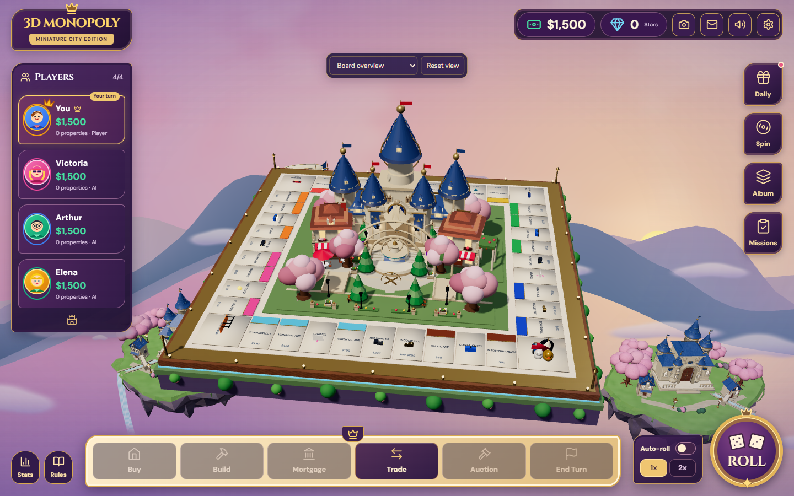
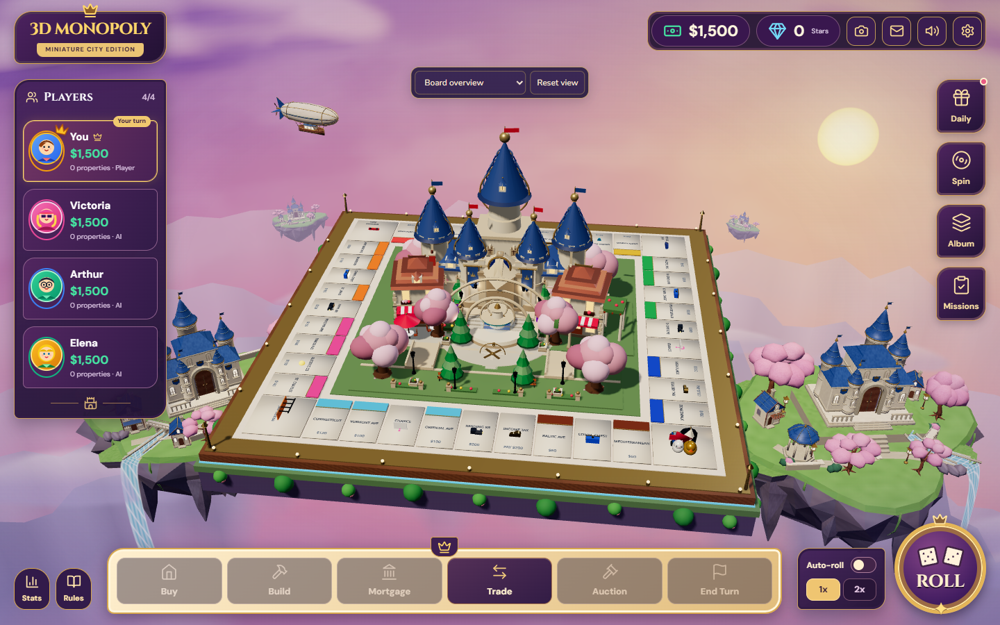
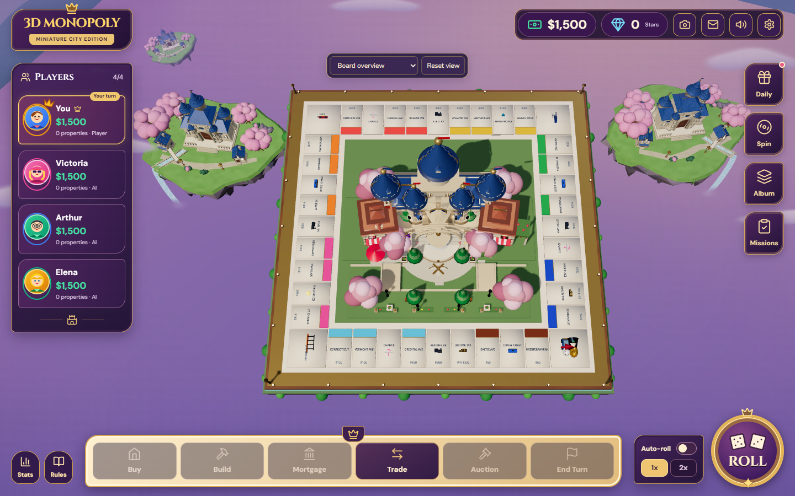
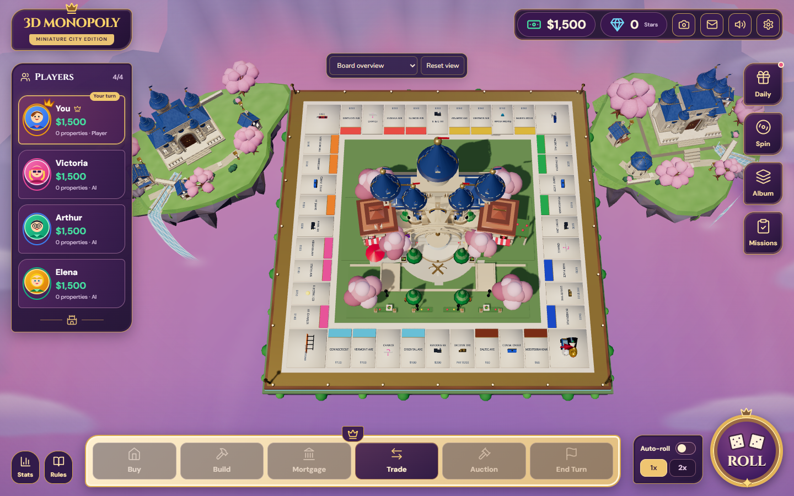

# Fantasy background polish

This builds on the merged Blender world at `98281c1`. The board, central city/castle, HUD, controls, gameplay, backend and dependencies are preserved. The supplied concepts guide the sunset palette, layered depth and distinct island gardens; the existing game assets remain the foundation.

## Audit and changes

The existing sky was mostly a gradient, the mountain horizon consisted of broad connected wave ribbons, and both islands shared almost the same house/tree layout. Their low world placement hid them behind the board and action dock at the supplied lower viewing angle. Water used a narrow strip with a hardcoded river route; the airship crossed the board's upper rim.

- Sky: sculpted cloud banks, high cirrus, lavender/rose/peach transitions and a defined world-fixed golden sun. Static cloud detail is baked once into a bounded GPU texture; runtime clouds and the airship provide subtle movement.
- Horizon: four separate irregular mountain silhouettes, with lighter distant layers, darker near layers and feathered atmospheric bases. There is no connected ground bowl.
- Left island: elongated crescent meadow, orchard/village composition, winding promenade, varied sakura, retaining walls and deeper fractured cliffs.
- Right island: a raised castle garden, steps, a blue/gold open pavilion, distinct village/tree placements and a wider waterfall outlet.
- Water: exported route/source/end/width anchors drive the river and falling sheet, with animated strands, foam edges and light mist. The material no longer fades the river before its cliff outlet.
- Composition: slightly larger main islands raised into the side background; supporting islands at smaller scales and greater depths; airship moved into clear upper-left sky. All scenery stays separate from the board footprint.
- Lighting: warm directional modelling and cool fill are applied only to cloned outer GLB materials. Existing board lights, exposure, tone mapping and shadows are unchanged. Distant assets use a soft atmospheric finish.

Optional large foreground branches and lanterns were omitted because the existing HUD already occupies the screen edges. No volumetric clouds, heavy bloom, fluid simulation or additional real-time shadow maps were added.

## Matched captures

The audit records the unchanged default overview and a representative lower view, `[4.5,27,40] → [0,.7,0]`, at 1440×900. The latter resembles the supplied in-game angle; its exact camera metadata was not available from the screenshot. Every automated before/after pair uses identical camera/viewport/DPR and seeded game state.

| Before | After |
| --- | --- |
|  |  |
|  |  |

## Asset generation and bounds

The upgrade retains the existing ten-material batching and one embedded 128² atlas per kingdom. Main island triangle caps remain **40k high / 25k balanced / 16k low / 8k distant**, with a 3 MiB per-file cap. Only the eight kingdom GLBs are revised; the foundation, standalone props and airship GLBs are preserved.

```sh
blender --background --factory-startup --python-exit-code 1 --python tools/blender/generate_environment.py -- --milestone final --only royal-island-left,royal-island-right
python tools/blender/validate_assets.py --manifest public/assets/models/environment/manifest.json --output docs/fantasy-polish/evidence/asset-validation.json
```

`generate_gardens.py` adds the reusable pavilion/wall/path modules. The existing island/vegetation/orchestration scripts control the distinct layouts. The exporter preserves custom effect-anchor metadata. Runtime falls read `watercourse_0..3_*`, `waterfall_origin_*`, `waterfall_end_*` and source width; no second coordinate-system conversion is applied.

## Validation and performance

Draft status: build and all 47 Node tests pass. See [measured performance and outstanding checks](performance.md), [binary asset inspection](evidence/asset-validation.json), and matched frame samples under `evidence/before` and `evidence/after`. The final gameplay/motion and WebGL context-recovery browser checks are pending. The standard project test suite also exercises rendering bounds, deterministic layouts, animations and malformed GLB rejection.

An early short checkpoint showed a large slowdown. Repeating that exact build recovered approximately baseline performance; disabling mountain/cloud passes showed no measurable difference. The report retains that diagnostic and avoids attributing transient GPU behavior to one effect. Final comparisons use warmed five-second samples with no concurrent Blender or browser workload.

## Modified areas

- Runtime environment: `FantasySky`, `DistantMountains`, `FloatingClouds`, `FantasyAirship`, `AnimatedWaterfall`, `PremiumFantasyWorld`, `GltfEnvironmentModel`, `FantasyEnvironment`, sun configuration and the new `atmosphereLayout` / `environmentMaterial` helpers.
- Blender: island, vegetation and orchestration generators; new garden generator; export metadata; eight kingdom GLBs and manifest.
- Verification: new atmosphere audit/cost and PNG comparison tools, cloud/ridge tests, environment regression output/budget settings, and this evidence/report directory. `package.json` adds an audit alias; no library is added.

The camera remains free to orbit, so the sun and background islands retain world positions instead of following HUD corners. Some background scenery can leave the viewport in close/top views. Fine masonry, individual petals and concept-level architectural detail remain art refinements beyond this bounded background pass.
