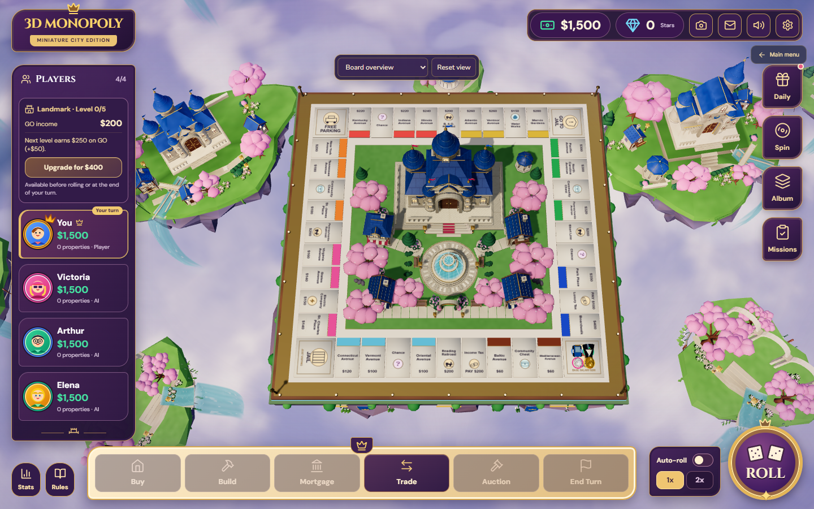
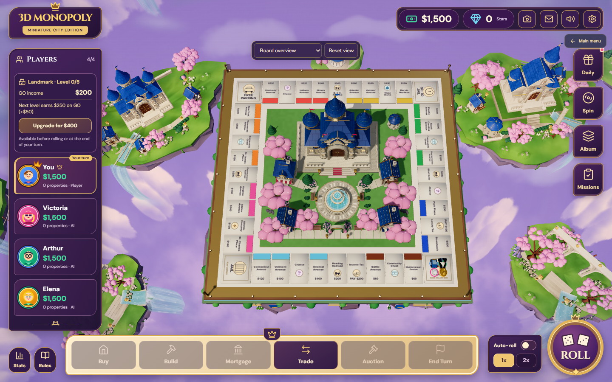
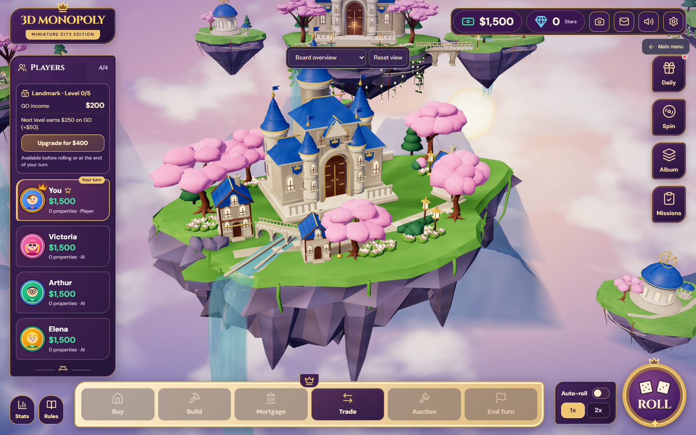
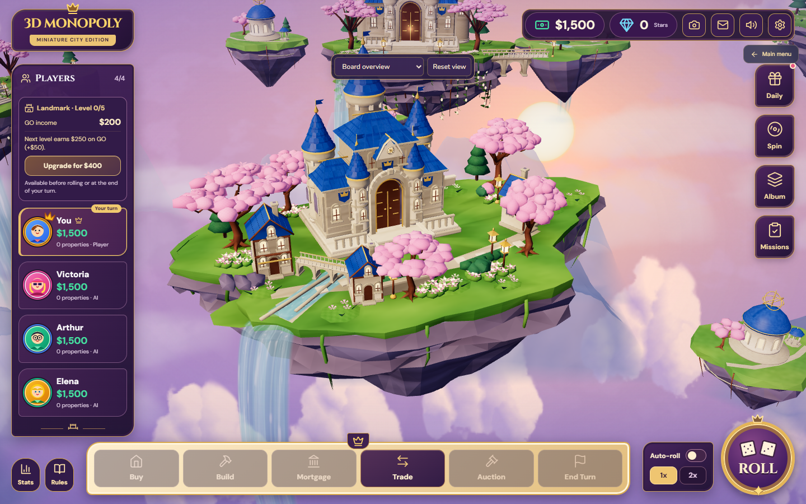

# Fantasy background overhaul

[Exact changed files](FILES.md) · [verification receipt](evidence/verification.json)

This pass rebuilds the surrounding floating kingdom using Blender-authored
geometry, original surface textures, baked contact lighting and lightweight
runtime water/atmosphere shaders. The five scenic island families have real
high/balanced/low GLBs. Blender is an offline authoring dependency only.

## Baseline and scope

The controlled gameplay baseline is stable main
`b30bb88` (PR #62), fetched before the branch was created. The supplied fantasy
kingdom imagery guides the pastel palette, blue slate/pale stone architecture,
layered floating landforms, cherry blossoms and luminous falling water.
All evidence below is captured from the actual application in Chrome; none is
a generated mockup or an offline beauty render.

Gameplay, board geometry/materials, central city, HUD, menu, camera placements,
camera controls, backend and multiplayer source files are unchanged. The existing
dirty `.phase1-baseline` gitlink is excluded from this change.

## Six environment changes

| Problem | Implemented change | Matched browser evidence |
| --- | --- | --- |
| Simple islands | Rebuilt undercut cliff courses and broad ledges replace repeated spikes; tessellated meadow rings, raised planted terraces and folded turf edges integrate the land surface. | [Before](evidence/before/island-left.png) / [after](evidence/after/island-left.png) |
| Toy-like buildings | Real staggered slate plates cover spires, hipped castle masses and nave roofs; projecting cornices, buttresses, side lancets, carved entrances and dormer frames add architectural depth. | [Before](evidence/before/island-right.png) / [after](evidence/after/island-right.png) |
| Ribbon waterfalls | Anchor-driven convex curtains broaden after the crest; separate raised folded sheets, animated internal flow, foam and overlapping dissipating mist replace the plain cyan strip. Two draws per waterfall remain. | [Before](evidence/before/waterfall.png) / [after](evidence/after/waterfall.png) |
| Blob vegetation | Smaller asymmetric blossom sprays overlap around visible boughs; branching twigs, rooted contact patches and bounded flower/leaf groups improve planting. Adaptive small-lobe treatment avoids multiplying already detailed garden crowns. | [Before](evidence/before/island-left.png) / [after](evidence/after/island-left.png) |
| Flat atmosphere | Three static cumulus bank tiers, fractal fringes, lower cloud sea, periwinkle/peach sky and solar aureole separate the depth layers; ridge shoulder highlights and ravine tint refine the distant mountains. | [Before](evidence/before/sky-depth.png) / [after](evidence/after/sky-depth.png) |
| Even lighting/materials | An original embedded 256px masonry/slate/meadow/mineral atlas, material-specific reflectance, broad meadow color zones, new-piece cavity shading and three-tap offline sun shadows give the environment stronger grounding. | [Before](evidence/before/fantasy-world.png) / [after](evidence/after/fantasy-world.png) |

The initial checkpoint was rejected during review: main roofs still lacked
hipped slate relief, the meadow felt empty and the sky remained diffuse. A
second geometry/atmosphere pass and a final material/contact-lighting pass were
completed before the release captures. A shared Blender mesh tint regression
was caught visually, fixed by copying every baked instance, and covered by an
actual exported-blossom brightness check across all fifteen GLBs.

## Real screenshots







All nine [before](evidence/before/views.json) and [after](evidence/after/views.json)
poses retain the same camera, viewport, quality, DPR and random seed. The sets
include overview, 1920px fantasy world, wide world, both hero islands,
waterfall, sky depth, phone and short landscape. Screenshot animation is frozen
using the real reduced-motion preference.

The fixed 460×480 board interior comparison contains **220,800 identical
pixels**, with zero changed pixels and zero channel delta. See
[board-preservation.json](evidence/board-preservation.json). All forty board
spaces remain unoccluded in the default desktop and responsive captures.

## Assets and authoring

Only these five families are regenerated, each with three independent LODs:

- `royal-island-left-final-v1{,-balanced,-low}.glb`
- `royal-island-right-final-v1{,-balanced,-low}.glb`
- `royal-island-citadel-final-v1{,-balanced,-low}.glb`
- `sky-garden-final-v1{,-balanced,-low}.glb`
- `sky-windmill-final-v1{,-balanced,-low}.glb`

The [manifest](../../public/assets/models/environment/final-background-manifest.json)
binds source GLB hashes, generator/helper hashes, Blender version, triangle
counts, exact exported bounds, byte sizes, material names and water anchors.
Existing background-V1 and original garden/windmill bytes remain immutable.
Assets and textures are original project MIT work; no external asset download
or paid generation service was used.

The final geometry policy is restricted to those five families. Hero caps are
55k/38k/24k triangles and secondary caps are 18k/15k/12k. Every asset is below
4 MiB, has one embedded 256×256 atlas and at most ten material primitives.
The previous asset families retain their existing validation policies.

| All five scenic families | Low | Balanced | High |
| --- | ---: | ---: | ---: |
| Actual triangles | 66,408 | 117,741 | 176,543 |
| Combined GLB bytes | 5,165,836 | 9,132,768 | 13,328,288 |

```powershell
& 'C:/Program Files/Blender Foundation/Blender 5.2/blender.exe' --background --factory-startup --python-exit-code 1 --python tools/blender/final_background_overhaul.py
node --test tests/final-background-assets.test.mjs
npm.cmd run build
```

## Verification and performance

- Production TypeScript/Vite build passes.
- All five actual final-asset checks pass, including source hashes, anchors,
  portable geometry, unit normals, texture colors, LOD budgets and nonblack
  blossom tints. All thirteen original environment asset tests pass.
- The 51 existing solo/gameplay and scenic material tests pass. Focused
  atmosphere and waterfall geometry tests pass.
- Final browser captures report zero rendering errors and zero asset fallbacks.
- Reduced motion, resumed motion and hidden-document freezing pass. Four
  scene mounts retain bounded allocations and download each GLB/atlas once.
  Optional GLB and cloud PNG failures remain contained with board picking intact.
- WebGL context restoration passes on all three qualities; 24,700 static sky
  pixels per tier are byte-identical before/after recovery.
- All forty spaces pass real mouse/touch picking at four viewports. Camera
  modes and reset/orbit/zoom work, and real roll/buy/end-turn smoke passes.
  See [the interaction report](evidence/regression/results.json).

Performance is measured on the local AMD Radeon 610M through ANGLE/D3D11;
results are observations for this machine. The [paired benchmark](evidence/paired-performance.json)
runs A/B then B/A at each quality, one fresh page at a time, normal motion,
1440×900, browser DPR 1 (the unchanged low-quality renderer caps its own DPR
at 0.9), three seconds warmup and five seconds per sample. Its
counterbalanced results are the performance source of record.

| Quality | Before FPS | After FPS | Change |
| --- | ---: | ---: | ---: |
| Low | 161.4 | 161.7 | +0.2% |
| Balanced | 71.6 | 70.2 | −2.0% |
| High | 74.7 | 65.0 | −13.0% |

High quality is measurably more expensive in both pair orders: median GPU time
increases from 11.10 to 12.65 ms and rendered scene triangles from 443,732 to
515,318. Balanced samples have substantial run-to-run variance; the paired
result does not reproduce an earlier isolated 38% slowdown. These are short
local samples, not a sustained minimum-FPS guarantee. Raw repetitions and
frame samples remain available in the report. Heap snapshots vary with GC
timing and are not presented as retained-memory or VRAM measurements.

Geometry and model downloads increase deliberately for the art upgrade. Scene
draws increase by one; waterfall draws remain two each, with no new realtime
shadow casters, fluid simulation, refraction or postprocessing passes. Sky
detail is baked once at mount/quality/context restoration, not every frame.
The larger static sky texture adds 1.5/6/13.5 MiB on low/balanced/high; the five
256px model atlases add about 0.94 MiB without mipmaps compared with five 128px
atlases. The game loads the selected quality rather than all fifteen GLBs.

## Remaining limits

The cliff and foliage language remains deliberately faceted and stylized at
close range. Contact lighting is baked; it does not react to the moving airship.
Water is a layered transparent effect with soft termination, without scene
refraction. The unchanged central city retains its existing art. The supplied
concept illustrations have much denser fine detail than the browser scene;
these captures document the implemented result at the actual play camera.
