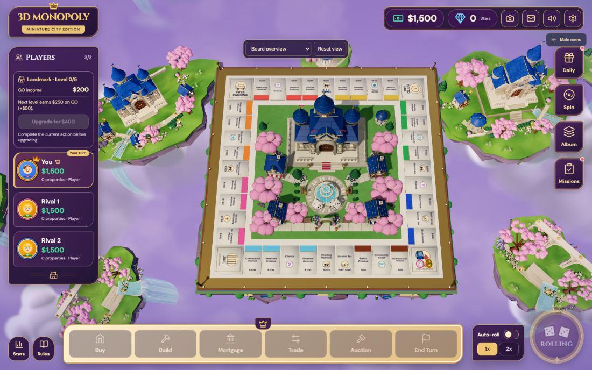
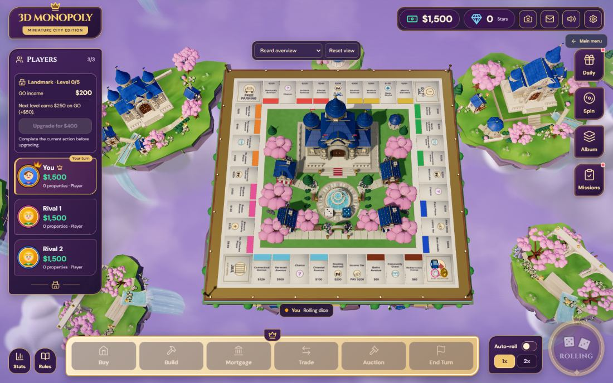
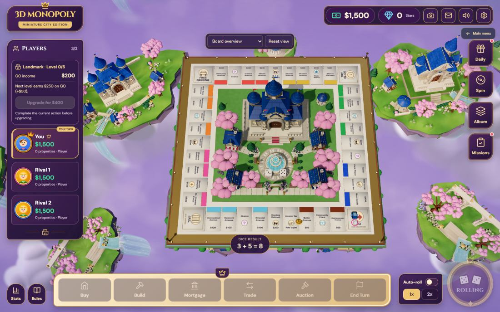
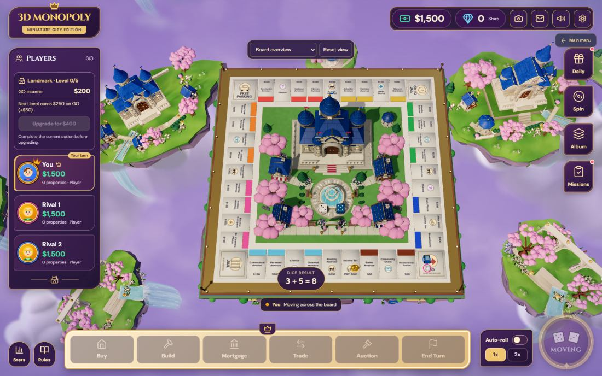

# Gameplay evidence

## Dice and motion

These are six frames from the running game in each build. Both runs use the same 3 + 5 roll. The token visits spaces 1 through 8. The post-render traces hold dice orientation, token position and committed tile for each sampled frame.

| Moment | Baseline | V7 |
| --- | --- | --- |
| Throw |  |  |
| Committed faces |  |  |
| First hop |  |  |
| Crossing |  |  |
| Approach |  |  |
| Landing |  |  |

[Baseline trace](before/motion-trace.json) · [V7 trace](after/motion-trace.json) · [Dice matrix](dice-matrix.json)
