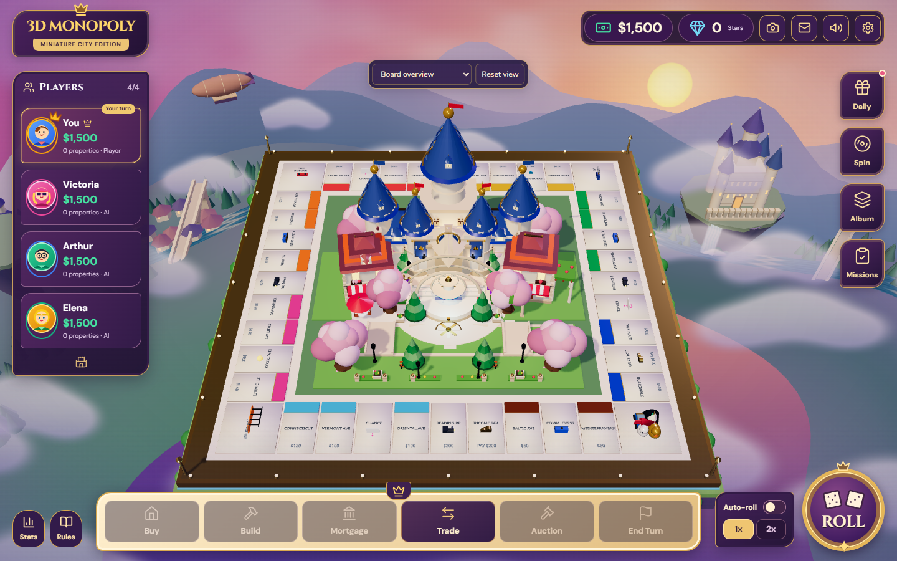
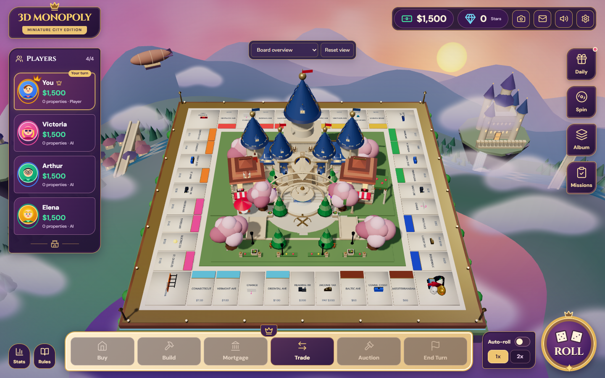
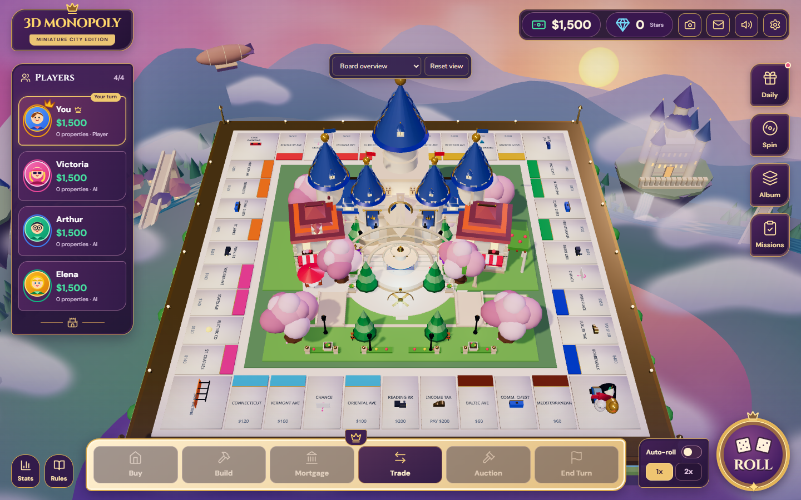
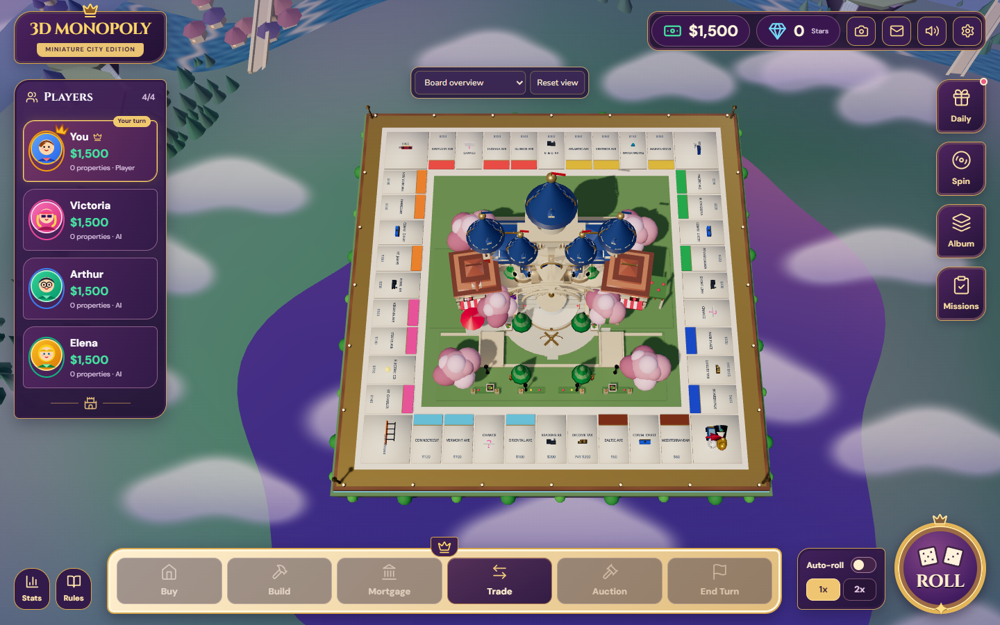

# Phase 1 — premium 3D graphics foundation

## Scope and baseline

This phase improves the existing miniature fantasy board, retaining its castle geometry, scenery, HUD, gameplay, controls and animations. The PR targets `main` at `44c383b340b97b1039c5e8c78bf2dfb05bc6c481`. The original local checkout was older; its exploratory captures were replaced with captures of current GitHub main before the final comparison. Existing uncommitted work in the original checkout was left intact.

What already worked: ACES tone mapping, bounded low/balanced/high DPR, one shadow-casting key light, instanced tile bases and tops, shared castle palette, animated procedural architecture, deterministic instanced outer scenery, reduced-motion support, and six cinematic camera presets. There was no active post-processing composer to preserve or replace.

The main costs were thousands of small mesh submissions and four transmissive materials that caused a second scene render. Several broad fills and point lights flattened the surfaces. Glossy near-white tiles, saturated roofs and very smooth metallic details competed for attention. The original overview let the main spire overlap the rear property row.

## Changes

- Lighting: one warm key at `[-12,28,16]`, restrained cool fill and neutral hemisphere/ambient light. Removed two local point lights and one broad fill. Kept the existing distant sunset accent. Exposure remains 1, ACES and sRGB are explicit, and the original atmospheric background is retained.
- Shadows: retained 1024 balanced / 2048 high PCF soft maps; refined normal/depth bias and shadow near/far bounds. Low still disables real-time shadows. Ground-local ambient contact uses 15 instanced feathered patches: one draw, 30 triangles, no render targets, extra scene pass or texture. This is deliberately limited contact occlusion, **not full scene SSAO**; baked asset AO remains a later task.
- Camera: a tested perspective fit includes the complete board/plinth and the 11-unit castle envelope within the current HUD margins. The steeper overview clears the rear tile centers. Off-axis projection centers the board in the useful area, and close presets clear that projection offset. Orbit, zoom, reset, selection, player, movement, dice, event, overhead and reduced-motion behavior remain available. Narrow views retain the whole board; small text still benefits from zoom.
- Materials: ivory satin tiles, rough limestone/paving, blue glazed slate, muted terracotta, brushed brass and quieter foliage. The frame is satin walnut with a deterministic 128×32 RGBA grain texture (16 KiB of source texels). Water and the emissive gem use opaque stylized PBR shading, eliminating the full-scene transmission prepass while retaining water/crystal animations. No HDRI, reflections, bloom, depth of field or new dependency was added.

## Visual evidence

The matched views use the same 1440×900 viewport, DPR setting, 40° FOV, camera `[0,32,30]`, target `[0,0.5,0]`, seed and initial game state. Animated decorations continue during sampling, so these are matched-angle comparisons rather than pixel-identical animation frames. The improved default overview is shown separately.

| View | Before | After |
|---|---|---|
| Balanced, matched camera |  |  |
| Balanced, default overview |  |  |

Low/high matched views, viewport screenshots and all raw frame samples are in [evidence](evidence). [SHA-256 hashes](evidence/sha256.json) identify the delivered captures.

## Performance

Windows, headless Chrome 156, Three r164, AMD Radeon 610M through ANGLE/D3D11; Node 24.21.0 and Vite 5.4.21. Production builds, one browser workload at a time, fixed seed 10425058, four-second warmup, one-second camera settle and a ten-second sample per tier. At device scale 1, low renders at DPR .9; balanced/high render at DPR 1. High's 1.25 cap is retained but was not exercised by this viewport.

| Tier | FPS before → after | Draw calls/frame before → after | Submitted triangles/frame before → after | Median CPU render ms before → after | Median GPU ms before → after |
|---|---:|---:|---:|---:|---:|
| Low | 24.3 → 55.1 | 3,433 → 1,767 | 288,942 → 145,943 | 29.1 → 9.0 | 39.1 → 17.2 |
| Balanced (medium) | 14.9 → 34.6 | 4,360 → 2,694 | 370,537 → 217,521 | 65.7 → 16.5 | 64.6 → 26.9 |
| High | 14.7 → 31.8 | 4,360 → 2,694 | 392,701 → 228,615 | 67.0 → 20.2 | 66.2 → 29.2 |

Counts include shadow and transmission work across the complete frame, with `renderer.info.autoReset=false`; they are **submitted workload**, not unique asset triangle counts. Geometry adds only the contact patches. Resident geometry allocations change from 1765/1766/1766 to 1766/1767/1767 across low/balanced/high. Resident texture counts remain 2/3/3: the transmission target is removed and the tiny wood texture is added. These are renderer allocation counts, not measured total VRAM bytes.

FPS is elapsed-frame throughput, not a desktop guarantee. CPU render time measures submission, not GPU completion. GPU measurements use asynchronous `EXT_disjoint_timer_query_webgl2`, rejecting disjoint results. Power state, thermals and unrelated machine workloads were not locked. This single-machine comparison shows a substantial structural cost reduction; it does not establish 60 FPS on all student laptops. Balanced/high still need mesh batching in the asset phase.

## Validation and reproduction

- Production build (`tsc && vite build`) and TypeScript lint pass.
- All 34 unit tests pass: existing animation/audio/environment tests plus 14 perspective/HUD fit tests at seven resolutions in overview and overhead modes.
- Browser results and exact checks are recorded in [results.json](evidence/regression/results.json). The scenario checks all 40 tile centers for clipping, city occlusion and physical picking at 1440×900, 1366×768, 768×1024 and 390×844, plus camera controls and a real roll/move/Baltic purchase/end-turn sequence. No runtime page errors are accepted. Mobile tests wait for the overview to return after closing each deed before reusing its projected coordinates.
- `git diff main` leaves gameplay store, data, API types, App, HUD, backend and environment modules unchanged. Castle geometry arguments, transforms and animation callbacks are unchanged.

Run `npm run build`, then `npm run preview -- --host 127.0.0.1 --port 4175 --strictPort`. In another terminal, run `npm run audit:graphics -- candidate`, `npm run test:graphics-browser`, and `node --test tests/*.test.mjs`. Set `CHROME_PATH` if Chrome is installed elsewhere; set `AUDIT_URL` for another preview port. The opt-in `?graphicsAudit` probe is inactive during ordinary play.

For the before build, create a detached worktree at the pinned SHA and run `node scripts/prepare-graphics-baseline.mjs <baseline-checkout>`. This copies only the identical diagnostic probe and runner into that checkout and injects the opt-in hook, leaving rendering unchanged. Install the same dependency versions, build and preview that checkout on another port; set `AUDIT_URL` to it and run its audit script with label `baseline`. Run scenarios sequentially. `node scripts/summarize-graphics.mjs` rebuilds the comparison and evidence hash manifest.

## Later Blender asset upgrade

1. Preserve the current castle silhouette, blue/ivory/gold palette, footprints, landmark levels and animation anchors. Export a single measured GLB with explicit unit scale, origins and material names; validate all levels against the same camera/tile-occlusion scenario.
2. Merge static wall/roof sections and atlas repeated window/trim materials. Instance repeated windows, finials and vegetation. Thousands of tiny objects remain the main CPU/submission problem; adding polygons will not solve it.
3. Bake soft contact/cavity AO and modest bevel/roof-tile normals into shared textures. Replace temporary ground contact patches only after the new asset supplies comparable grounding. Cap texture sizes against a measured laptop budget, with mipmaps and disposal checks.
4. Resolve existing terrain intersections: canal water currently lies below the foreground grass slab; several connecting pavements are also buried by raised terraces. Fix their topology/elevations together in the diorama asset instead of layering new effects over them.
5. Author meaningful low/medium/high LODs and shadow-caster proxies, then repeat the matched-camera captures, full-frame workload measurements, quality switching, landmark upgrades and gameplay smoke test. Validate on an additional integrated-GPU laptop and a desktop before claiming a universal frame-rate target.
