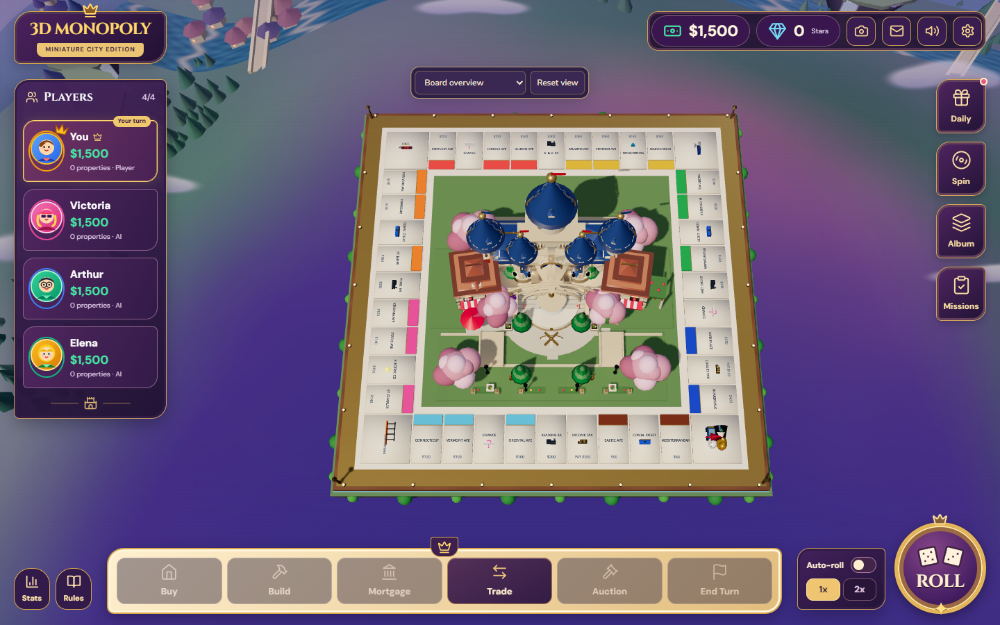
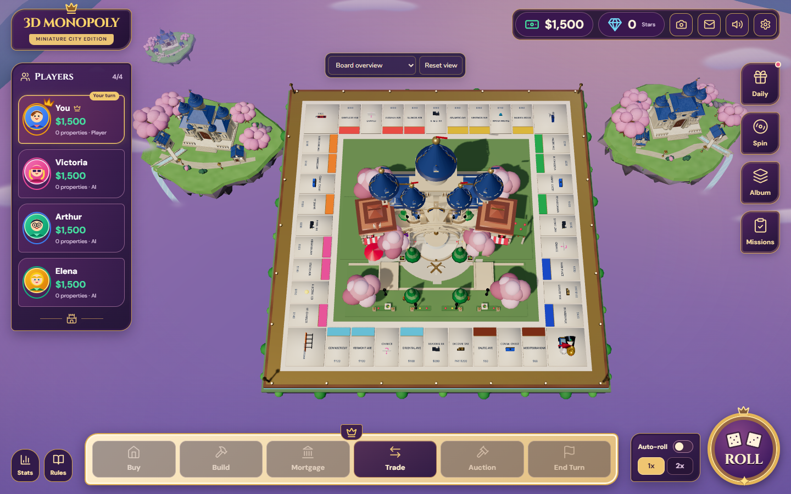
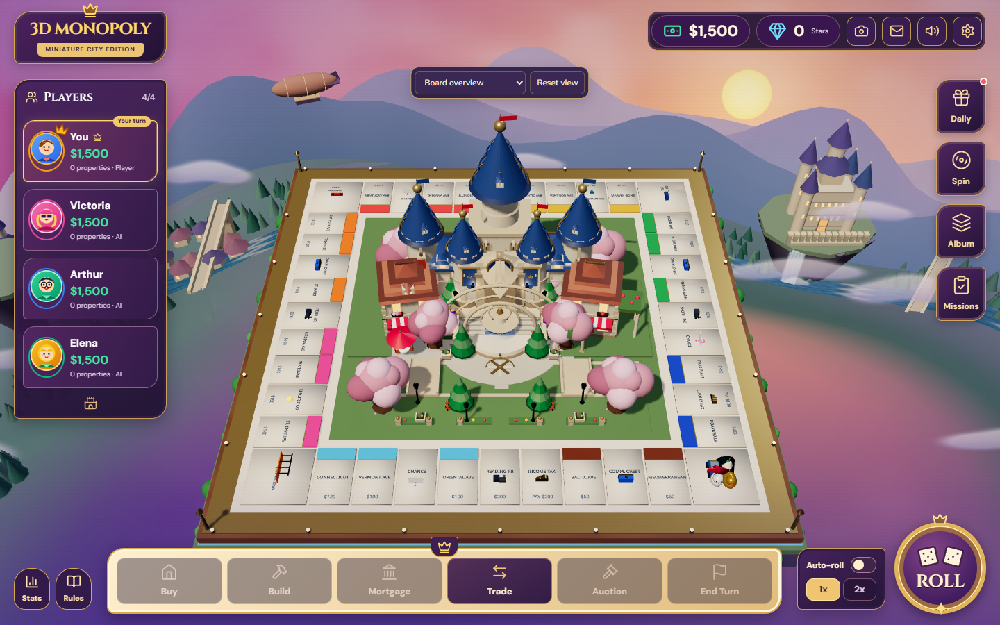
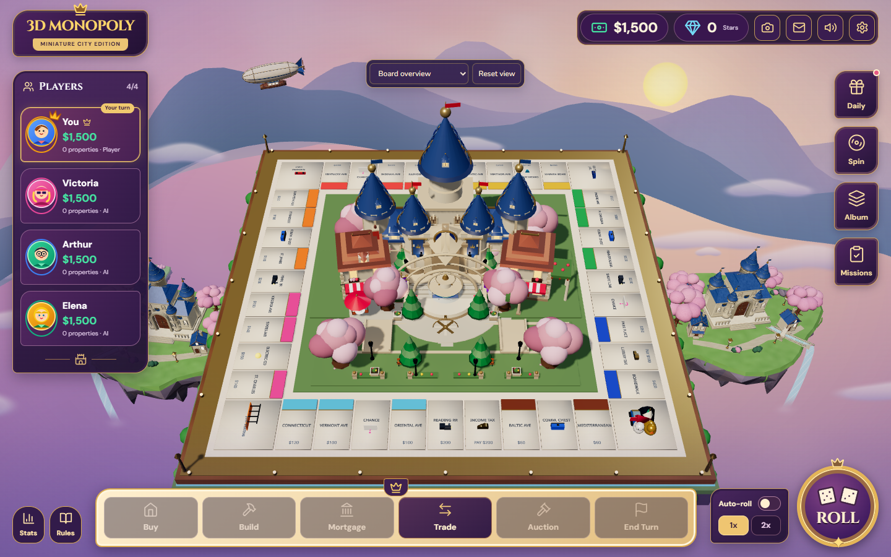

# Blender fantasy world — phase 2

The outer environment now uses actual Blender-authored, textured GLBs: two distinct floating kingdoms, ivory/blue/gold castles, village houses, sakura trees, gardens, bridges and lanterns. A Blender airship and lightweight runtime water/mist complete the scene. The board remains the main focal point; its geometry, central castle, tokens, dice, camera controller, lighting, HUD and game rules are unchanged.

## Composition and original cause

The previous `DistantLandscape` mounted a continuous annular valley around the board. Its near radial rim and convex height variation read as a raised foreground mass from the overview camera. Moving that surface down reduced the problem in phase 1 but retained a connected land bowl. Procedural kingdom/waterway meshes also depended on this ground surface.

`FantasyEnvironment` now unmounts the annular valley, old kingdom and old waterways entirely. Only the existing distant mountain ridges remain. The new independent islands have irregular flat meadow tops, broken cliff strata and tapering undersides. Main placements are `[-33,-38,-28]` and `[35,-38,-30]`, scale `1.25`; no terrain spans the gap beneath the board. Waterfalls are anchored to the outward island edges. Clouds retain the prior low, outward placement and single instanced billboard pass. The sky palette is softened toward lavender/peach without adding a render pass or changing gameplay illumination.

The live browser check confirms the old valley/kingdom are absent. Physical geometry rays confirm the environment hides none of the 40 property centers in overview at desktop, tablet and phone sizes, top view or the existing focus presets. Main islands can be partly hidden by the HUD or board in closer camera modes; they stay in world space instead of following the camera. The steep gameplay overview shows less cliff height than the lower reference view. The camera was deliberately preserved as requested.

## Matched screenshots

Every before/after pair uses identical camera position, target, FOV, view offset, viewport, DPR and seeded game state. These are actual production browser captures, not Blender renders or composited concepts.

| Balanced overview before | Balanced overview after |
| --- | --- |
|  |  |

| Balanced three-quarter before | Balanced three-quarter after |
| --- | --- |
|  |  |

[Low](evidence/after/low-overview.png), [high](evidence/after/high-overview.png), [top](evidence/regression/top-view.png), [phone](evidence/regression/overview-390x844.png), and milestone [A](evidence/milestone-a/balanced-overview.png), [B](evidence/milestone-b/balanced-overview.png), [C](evidence/milestone-c/balanced-overview.png) captures are included.

## Completed work and validation

| Milestone | Export and integration | Verification |
| --- | --- | --- |
| A | Real foundation island; old valley unmounted | Existing foundation GLB preserved; decoded texture/UV verification, build, matching-camera browser import and picking checks |
| B | Left/right castle and house composites | Actual binary/manifest validation, build and two camera captures with short render samples |
| C | Sakura, gardens, bridges, lanterns, all LODs, airship, water and mist | 22 actual GLBs including foundation; byte/material/texture/budget validation, build, matching-camera browser checks |
| D | Distant atmospheric tint, softened sky/water edges, instancing/resource cleanup | Full quality performance comparison, all camera controls, mouse/touch picking and a real gameplay turn |

Build passes. `node --test tests/*.test.mjs` passes **45/45**. Browser regression passes at 1440×900, 1366×768, 768×1024 and 390×844, including all 40 physical tile rays plus real mouse hover or touch selection. Top view, player/dice/movement/event/overview presets, reset, orbit, zoom and deed selection pass. A real [1,2] dice roll reaches Baltic Avenue, purchase assigns owner 0 and balance $1440, and End Turn advances to player 1. No browser rendering errors were recorded.

Live browser motion checks pass for animated airship/water, reduced-motion changes, hidden-tab guards and resumption. Ordinary gameplay exposes no audit globals. New background GLBs cast zero real-time shadows. No backend, API, game logic, camera or HUD source is changed.

[Performance report](performance.md): overview FPS **66.6→72.5 low**, **38.9→40.7 balanced**, **34.7→38.3 high** on the measured Radeon 610M machine. Balanced three-quarter is **36.2→35.8**, about -1%. Increased triangle counts and additional atlas allocations are disclosed. These results do not guarantee 60 FPS on other student laptops.

[Asset inventory/budgets](assets.md) lists indexed triangles, sizes, material draw counts and texture memory estimates for every GLB. [Generation instructions](../../tools/blender/README.md) explain exact commands, coordinates, partial updates and validation. Individual source/export receipts are in [manifest.json](../../public/assets/models/environment/manifest.json); the unchanged A checkpoint has a separate foundation manifest.

## Changed files

- `tools/blender/`: `core.py`, `generate_environment.py`, `generate_floating_islands.py`, `generate_castles.py`, `generate_villages.py`, `generate_vegetation.py`, `generate_bridges.py`, `generate_lanterns.py`, `generate_airship.py`, `export_assets.py`, `validate_assets.py`, and the README.
- `public/assets/models/environment/`: 22 GLBs and the two generation manifests. Standalone props are reusable exports and are not downloaded by the game unless mounted.
- `src/components/environment/`: updated `FantasyEnvironment.tsx`, `FantasySky.tsx`, `FantasyAirship.tsx`; new `PremiumFantasyWorld.tsx`, `GltfEnvironmentModel.tsx`, `FantasyAssets.tsx`, `AnimatedWaterfall.tsx`, `AtmosphericClouds.tsx`.
- Diagnostics/tests: `src/components/3d/GraphicsAudit.tsx`, `scripts/phase2-audit.mjs`, `scripts/environment-regression.mjs`, `scripts/phase2-report.mjs`, `scripts/graphics-regression.mjs`, `tests/environment-assets.test.mjs`.
- `package.json` adds script aliases, `.gitignore` excludes Python/Blender caches, and this report/evidence directory records the work. No dependency is added.

## Later asset polish

The procedural assets establish the requested reusable Blender pipeline and runtime world. A later art pass can hand-tune cliff strata, reduce repeated masonry/roof patterns, create more distinctive house silhouettes and bake small-scale masonry/cobblestone/foliage AO into an atlas. These are visual refinements; there is no pending placeholder Three.js castle replacement in this environment. The existing central board castle remains a separate future decision and was not replaced here.

Inspect the captures with the art team before expanding detail budgets. Test additional integrated GPUs and prolonged gameplay/quality-switch memory before promising a device-wide frame rate. Bloom, volumetric clouds, fluid simulation, new maps and camera/HUD redesign remain outside this change.
