# Premium fantasy floating kingdom

The real-time gameplay world now extends through an archipelago of royal
islands, astronomical observatories, ruined sanctuaries and stream-side villages.
This builds on the actual main branch at `712693a`, which already contained two
Blender castle islands, vegetation, waterfalls, an airship and a baked sunset.
The attached user screenshot predates that foundation; it is not used as a
fabricated performance baseline.

The board, central castle/city, HUD, menu image, controls, rules, store, saved
progress, Solo/Online presentation and backend/API contracts retain their source.
Camera poses, FOV and responsive view offsets are preserved. The one rendering
correction moves fog and far clipping outward when the existing responsive
camera pulls far away: fixed fog previously erased the board at 844×390.

## Before and after

These production captures use the same seed, viewport, quality DPR and camera
pose, with reduced environmental motion. They are real browser renders.

| Main before | Feature after |
| --- | --- |
| 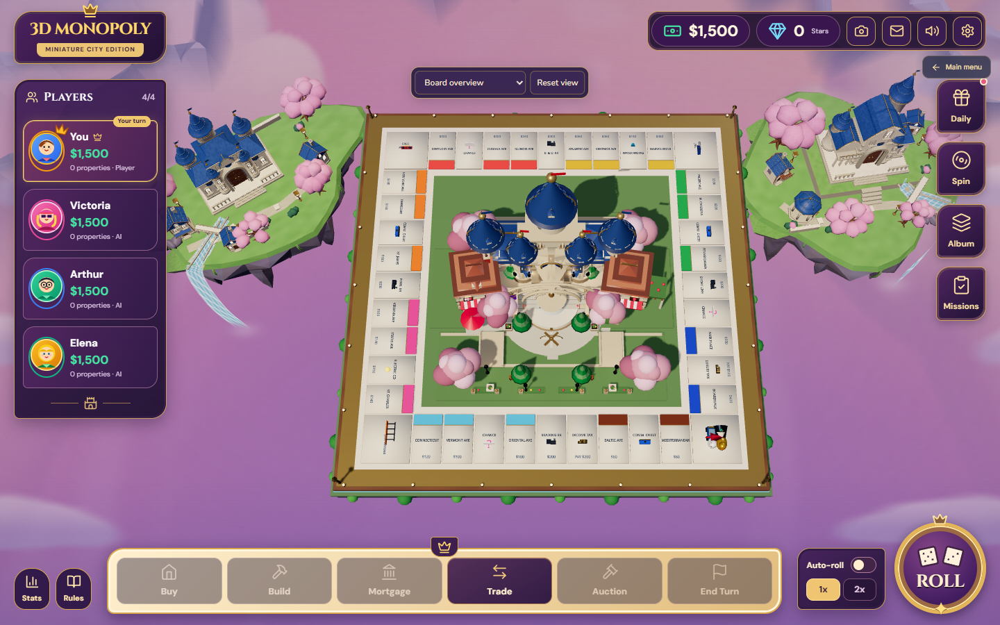 | 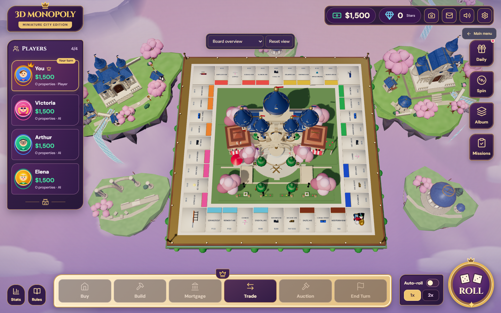 |
| 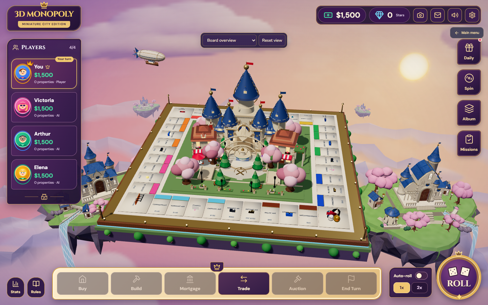 | 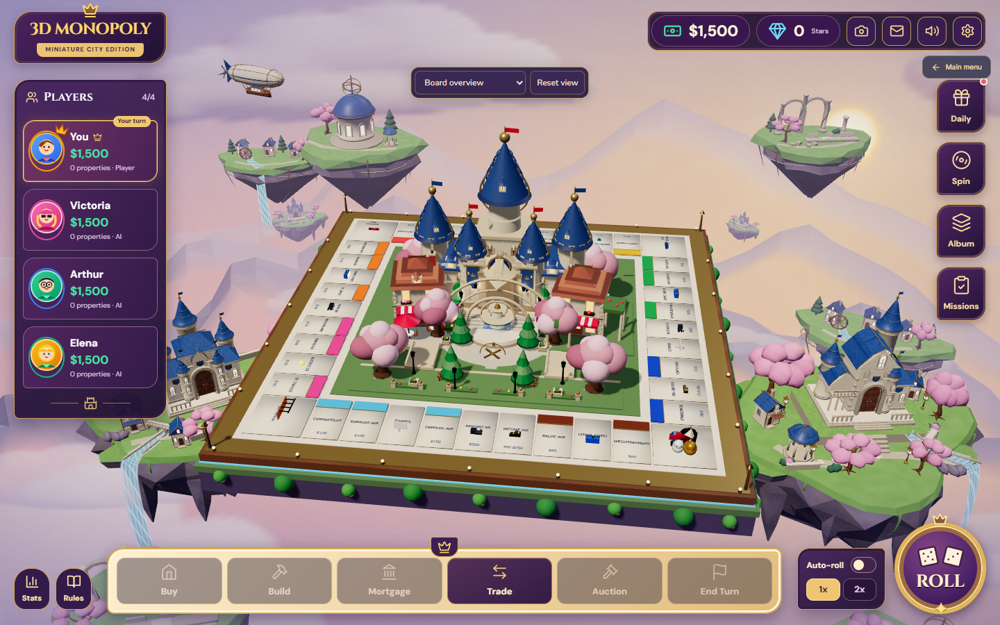 |
| 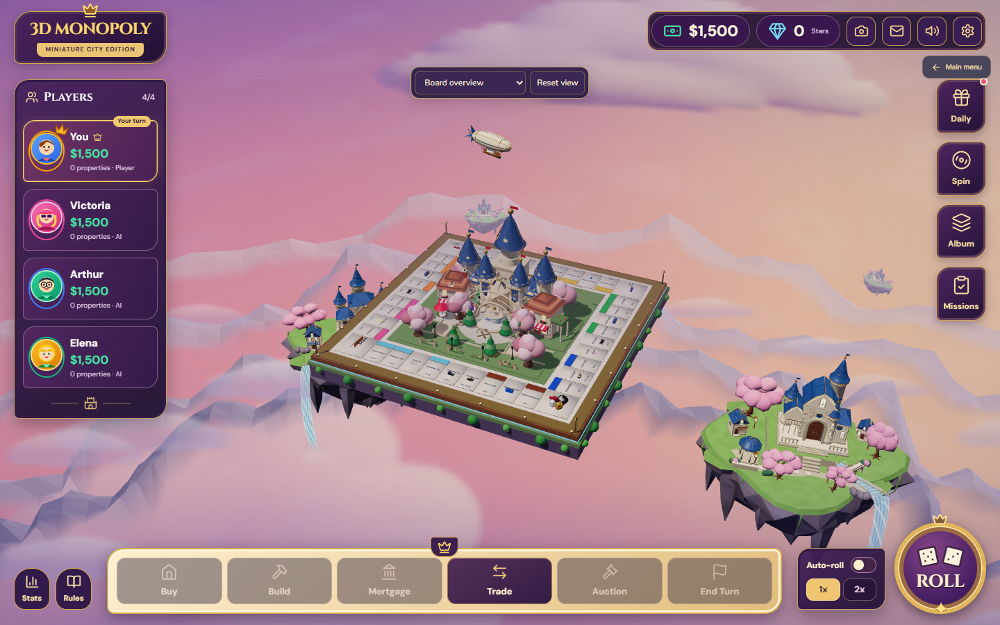 | 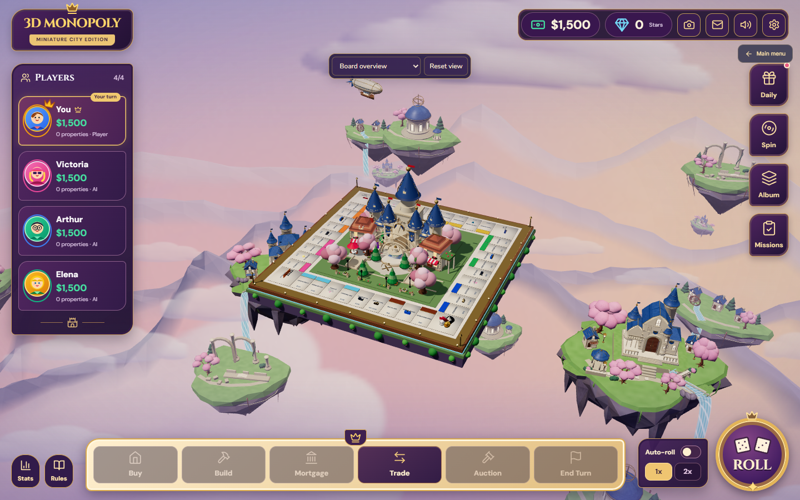 |
| 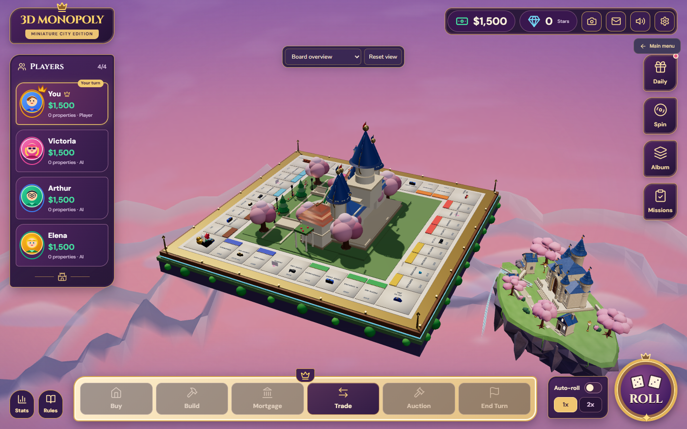 | 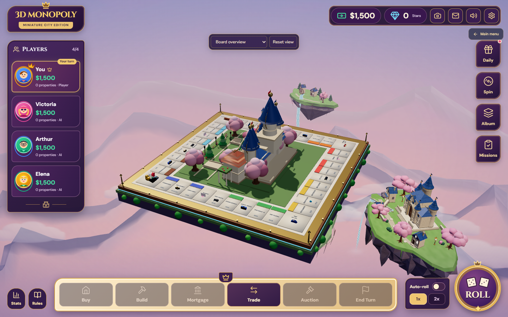 |
| 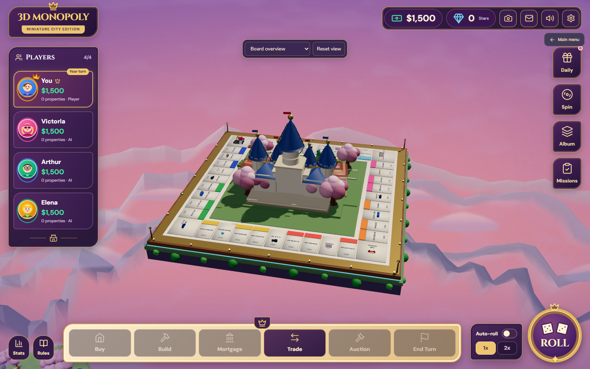 | 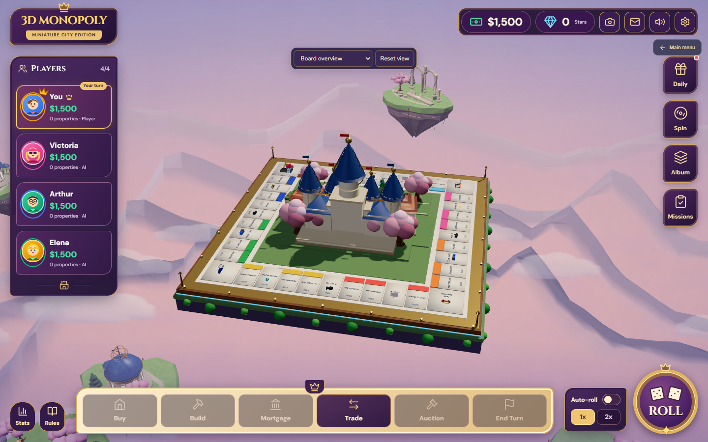 |
| 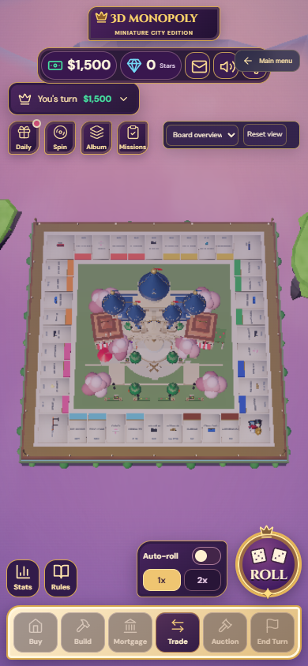 | 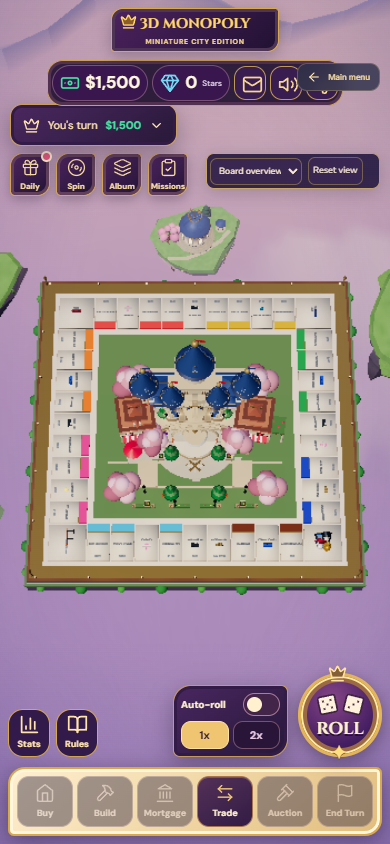 |
| 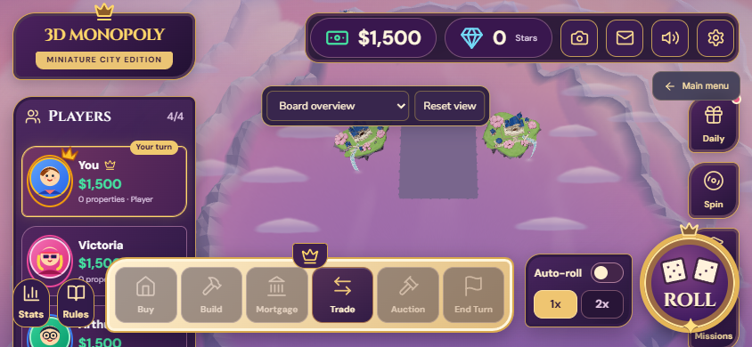 | 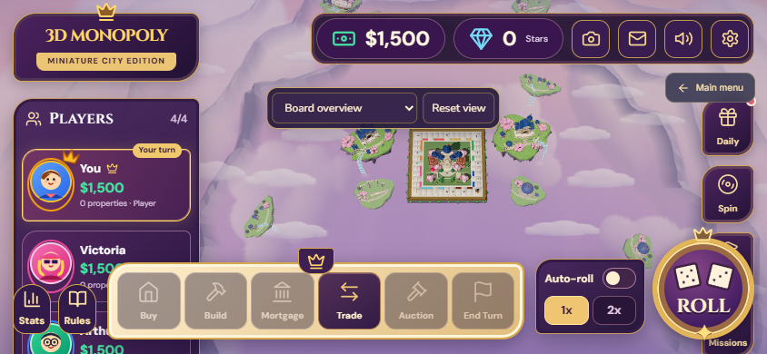 |

[High overview](evidence/controlled/after-high-overview.png) ·
[High lower view](evidence/controlled/after-high-reference.png) ·
[Low overview](evidence/controlled/after-low-overview.png) ·
[Low lower view](evidence/controlled/after-low-reference.png) ·
[1920×1080](evidence/after/high-desktop.png) ·
[1366×768](evidence/after/balanced-laptop.png) ·
[Close board view](evidence/after/balanced-close.png).

## Original assets and runtime integration

Installed **Blender 5.2.3 LTS** generated nine original, material-batched GLBs.
The observatory has an ivory windowed rotunda, swept blue dome, open gold
armillary, belvedere, sakura and pines. The sanctuary has open arches, varied
broken columns, climbing ivy, masonry fragments and an aqueduct remnant. The
hamlet has three detailed houses, a mill wheel with open spokes, pines, a carved
stream bed and exported waterfall anchors. Each has an asymmetric layered cliff,
exposed strata, meadow, paths and hanging roots.

All three receive high/balanced/low topology, UVs, normals, embedded 128px atlas
textures, applied transforms and a consistent ground pivot. Existing hero assets
are reused without regeneration. The new source is
[`generate_archipelago.py`](../../tools/blender/generate_archipelago.py), with
hashes, geometry counts and bounds in the
[`archipelago-manifest.json`](../../public/assets/models/environment/archipelago-manifest.json).
All geometry/atlas art is original project work under the repository MIT license.
No paid generator, external mesh or reference image is embedded.

Ten supporting destinations reuse three GLBs and **27 material batches**. Two
existing hero islands and quality-scaled distant kingdoms complete the layout.
Every quality keeps all ten supporting destinations; lower modes simplify the
meshes. All exported landmark envelopes remain below the board and outside its
column, and real geometry/ray tests check that scenery cannot hide a tile.
Background models have no input raycasts or shadow casters.

The sky retains its one-time bake, with cream/lavender cloud modelling, blue
upper air, peach light and a soft lower atmospheric shelf. Four mountain ranges
now use asymmetric overlapping massifs, lower-contrast distant layers and real
ridge flanks. The instanced cloud pass gains shaded lobes, variation and feathered
edges. Five anchored waterfall systems and the repositioned airship share the
existing R3F frame loop and live reduced-motion/visibility policy. No extra
postprocessing, lights, shadow passes or dependencies are introduced.

Individual GLBs use per-asset Suspense/error boundaries and explicit warnings.
An unavailable model gets a small local silhouette; healthy destinations and
the interactive board remain mounted. Readiness checks reuse individual loader
cache keys, avoiding duplicate GLB downloads. Instance-owned buffers/materials
are released while cached GLB geometry and atlases remain reusable.

Changed runtime files are `archipelagoLayout`, `SupportingKingdoms`,
`EnvironmentAssetBoundary`, `CameraAtmosphere`, `PremiumFantasyWorld`,
`FantasyEnvironment`, `AnimatedWaterfall`, `FantasyAirship`, `FloatingClouds`,
`atmosphereLayout` and `skyCloudBake`. `GraphicsAudit` gains query-only allocation
estimates and landmark/fallback diagnostics. Tests, reusable audit/report tools,
Blender documentation and the environment CI gate accompany those changes.

## Verification and measurements

[Performance tables, asset inventory and limits](performance.md) contain the
actual 24-window A/B and B/A comparison, frame-time percentiles, CPU/GPU timers,
draw calls, triangles, geometry/texture allocation counts, bundle growth and
local asset loading observations. [Raw frames](evidence/controlled/runs.json),
[all window summaries](evidence/controlled/summary.json),
[structured performance](evidence/performance.json) and
[build artifact hashes/check results](evidence/verification.json) are retained.
The pre-edit audit and earlier art checkpoints remain available too.

| Executed check | Result / evidence |
| --- | --- |
| `npm run build` | Passed; includes TypeScript compilation and Vite production build |
| `npm run build` in `backend` | Passed; source unchanged, used by the real browser test |
| `node --import tsx --test tests/*.test.mjs tests/online.test.ts` | 68 passed, 0 failed; [JUnit](evidence/unit-tests.xml) |
| Python GLB validation against both generation manifests | All 31 actual GLBs pass buffers, indices, bounds, texture pixel/UV checks and budgets; [inspection](evidence/asset-validation.json) |
| `premium-world-review.mjs before/after` | Eight additional matched views each; all 40 tile rays clear, including portrait, landscape, wide, close and reverse orbit; [final views](evidence/after/views.json) |
| `graphics-regression.mjs` | All 40 tiles via real mouse/touch at four sizes; top view, focus presets, orbit/zoom/reset, roll/move/purchase/end turn; [results](evidence/regression/results.json) |
| `environment-regression.mjs` | Five waterfalls, normal/reduced/hidden motion, no scenery shadows, low topology cap, no normal-play audit globals; [results](evidence/regression/environment-motion.json) |
| `premium-world-resilience.mjs` | Four mounts/unmounts, stable live allocations, one download per GLB across cycles, actual failed-download fallback with pointer selection, nested deployment URL; [results](evidence/regression/resilience.json) |
| `atmosphere-context.mjs` | Real context loss/recovery at all three qualities, with 24,700 identical static-sky pixels per quality; [results](evidence/regression/context-restore.json) |
| `online-browser.mjs` on fresh PostgreSQL + NestJS | All 10 real two-player scenarios pass, including authentication, room readiness, synchronized actions, reload, socket recovery, results and Solo AI; [results](evidence/online-final/results.json) |
| `CI=true online-browser.mjs` with ANGLE SwiftShader | All 10 scenarios also pass locally with the foreground/state-wait correction and actual environment readiness gate; [software run](evidence/online-software/results.json) |
| Final controlled rendering audit | Both run orders retain all 24 windows; camera/DPR, all board rays, served GLB hashes and console checks pass |

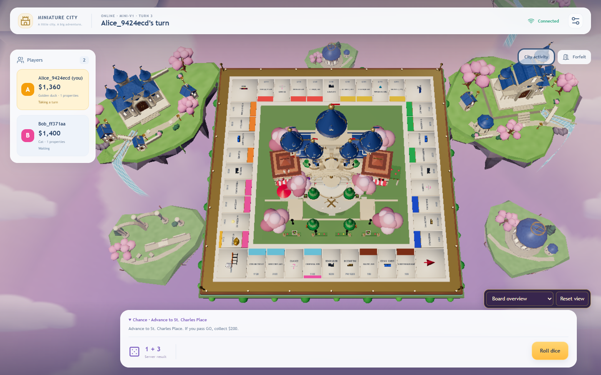

The CI workflow now also runs the environment placement and binary asset tests,
and triggers on model/generator edits. Local verification used Node 24.21.0;
required GitHub CI uses the repository's Node 22 configuration. Remote CI and
live deployment are separate from these local results.

The first Node 22 CI run passed the build, unit and GLB gates, then timed out in
the browser harness's rendered-state wait after reloading a client. Its
[failure record](https://github.com/10425058-jpg/3D-Monoply/actions/runs/43434128415)
is retained. The harness now foregrounds each client before inspecting its live
scene, polls the committed state independently of background animation frames,
uses the existing 120-second software-renderer budget in CI, and records expected
and observed values on failure. All synchronization assertions remain, and scene
readiness additionally requires the actual environment assets to load.

## Reproduce

Use the Blender regeneration/validation commands in the
[asset guide](../../tools/blender/README.md). Start the built candidate preview
on port 4175 and a separately built `712693a` baseline on 4176. The original
baseline production directory for this session is the ignored
`.online-test/premium-world-baseline`.

```powershell
npm.cmd run build
node --import tsx --test tests/*.test.mjs tests/online.test.ts
$env:COMPARISON_EVIDENCE_ROOT='docs/premium-fantasy-world/evidence'
$env:COMPARISON_LABEL='controlled'
$env:COMPARISON_BEFORE_PUBLIC_ROOT='.online-test/premium-world-baseline'
node scripts/kingdom-comparison.mjs
node scripts/premium-world-review.mjs after
node scripts/premium-world-resilience.mjs
node scripts/premium-world-report.mjs
```

Set `PREFIX_URL` to a production build served at a nested URL, such as
`http://127.0.0.1:4177/3D-Monoply`, for the subdirectory asset gate. The online
suite needs an isolated database and same-origin Nest server; it uses the
repository's existing real-browser harness without mocking API responses.

## Known limits

At 844×390, the preserved HUD leaves a small clear board area. Adaptive fog fixes
the previously invisible board, but the existing responsive fit still makes it
small; a landscape HUD redesign is outside this task. Close views naturally crop
world-fixed scenery. The small supporting landmarks use stylized topology and
an atlas rather than bespoke hand-painted masonry or sculpted individual petals.

One intermediate browser rerun against the reused test database timed out in
lobby join before mounting any 3D scene. Its cause was not established. The final
isolated-database run passes all 10 scenarios; the backend was not changed.

The optional `game-dev` CLI is unavailable. The installed Blender executable,
original bpy scripts, official glTF exporter, repository binary validator and
real Chrome tests were used directly. No CLI receipts or external validation
certification are claimed. GPU memory figures are allocation estimates/counts,
not driver VRAM. Local desktop measurements and phone-sized browser viewports
do not certify physical device performance or universal 60 FPS.
