# Sunset floating kingdom

This pass recreates the newly supplied fantasy concept as interactive scenery
around the existing Monopoly board. It starts from current main at `0fb8a2f`.
The reference is art direction only: no reference pixels are used in gameplay.

The surrounding world gains a tall eight-spire citadel, an actual open sky
bridge and lookout crag, a windmill hamlet, flowering marble belvederes, royal
garden dressing, and a fractured island foundation with blue crown banners and
trailing ivy beneath the unchanged board chassis. Ten new destinations join
the existing castles and supporting islands around the full camera orbit.

The waterfalls are convex, widening 3D curtains with flowing filaments, source
foam and dissipating mist. Their rivers and curtains share a draw; spray shares
another. The sunset has three wrapping cloud shelves, higher cumulus, four
procedurally shaded billboard variants, a warm solar disc, and four mountain
ranges with finer ridges and lit flanks. The royal blue airship drifts above the
skyline. Motion respects the live reduced-motion preference and tab visibility.

## Matched production captures

The poses, FOV, responsive offsets, DPR, seeded game and viewport match exactly.

| Before | After |
| --- | --- |
| 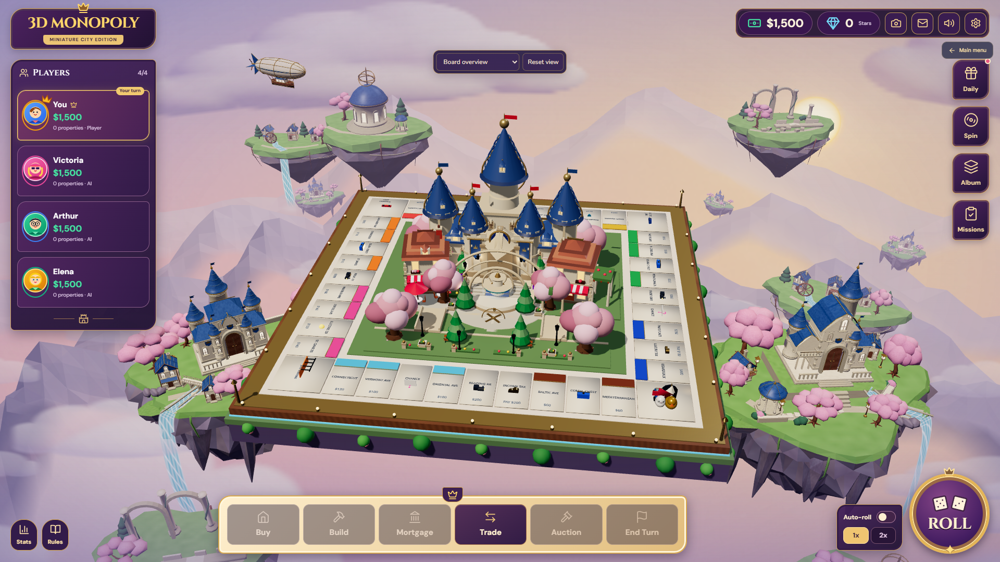 | 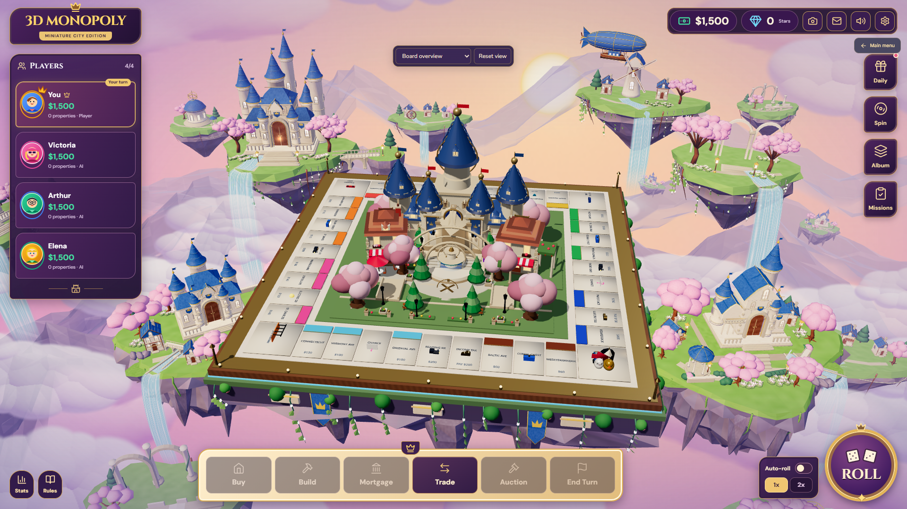 |
| 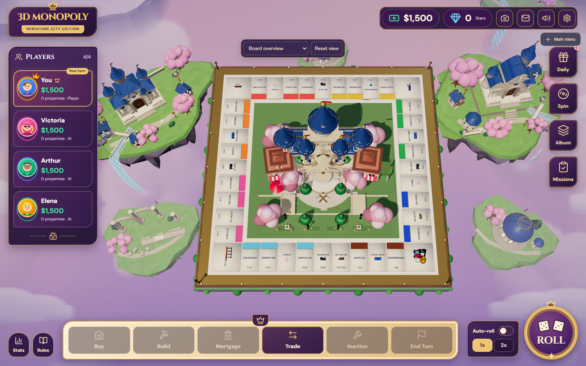 | 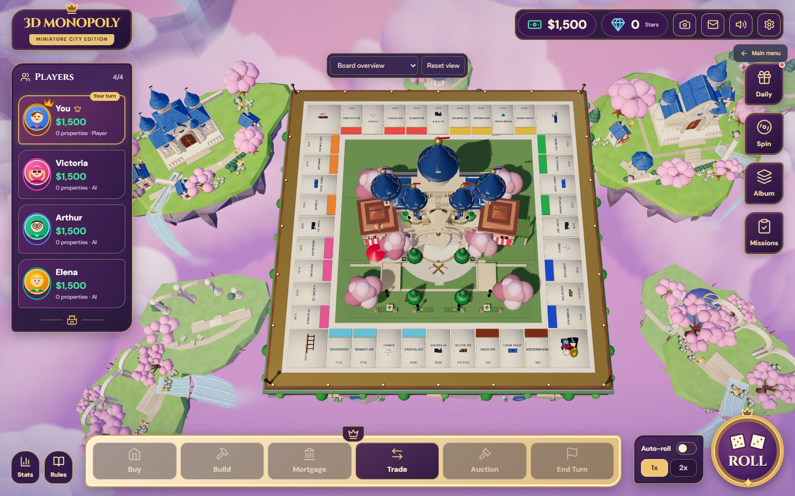 |
| 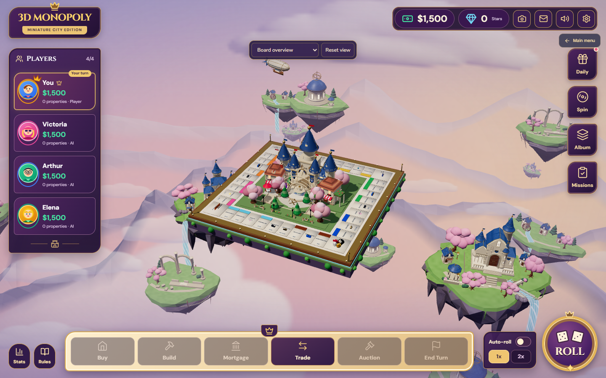 | 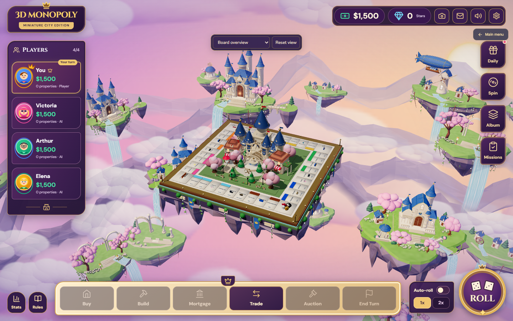 |
| 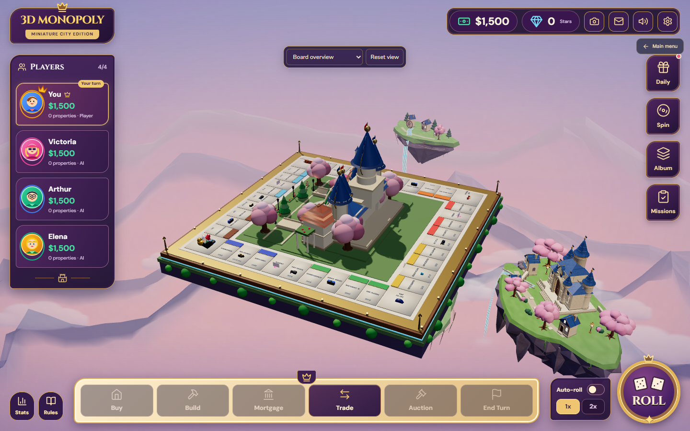 | 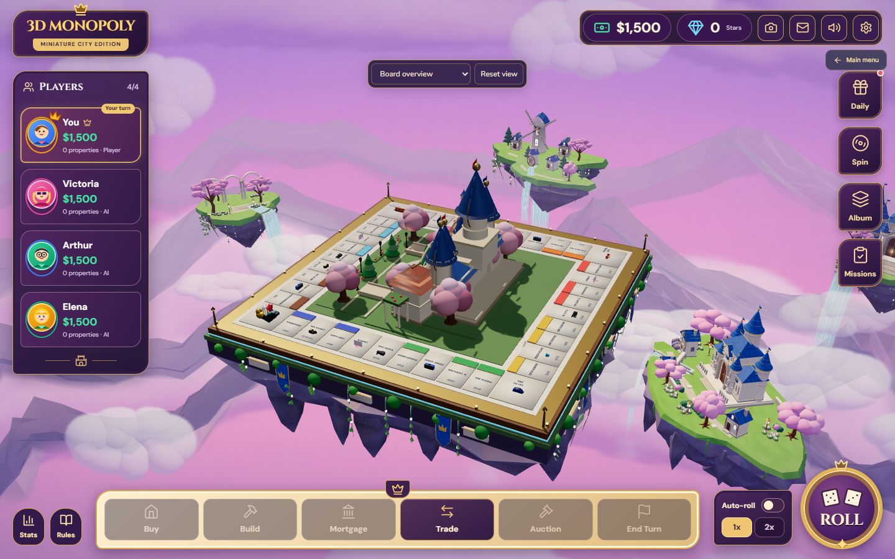 |
| 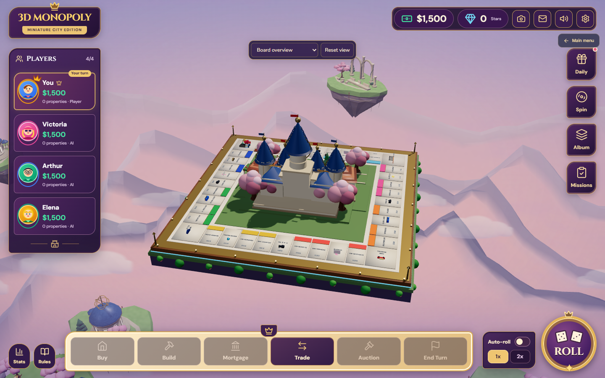 | 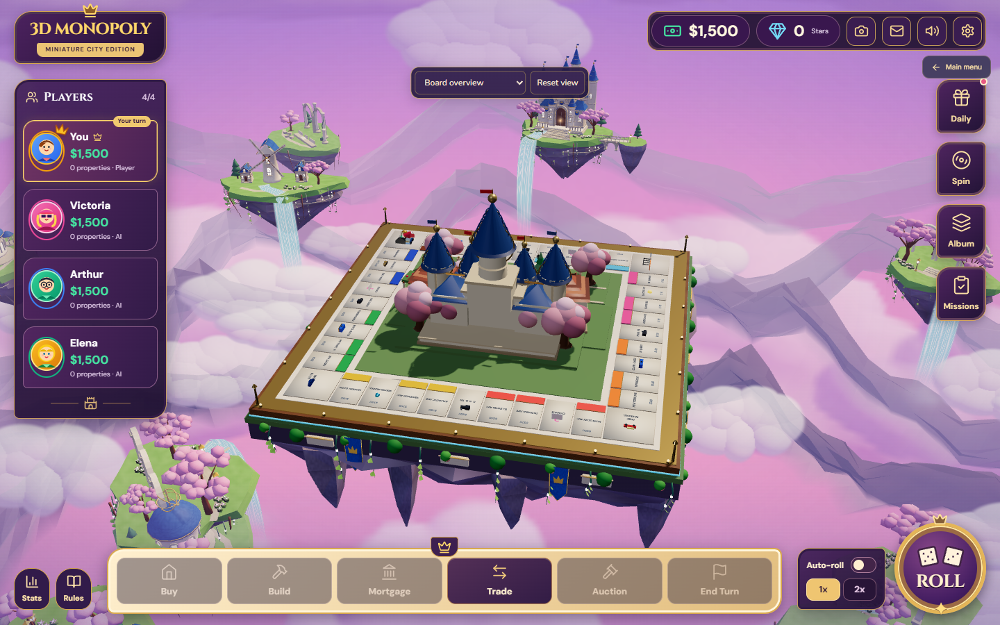 |
| 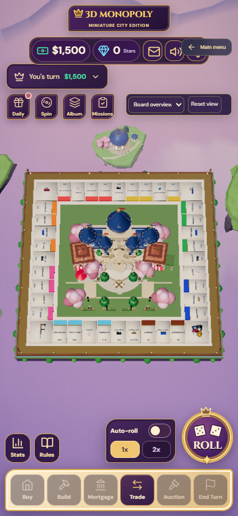 | 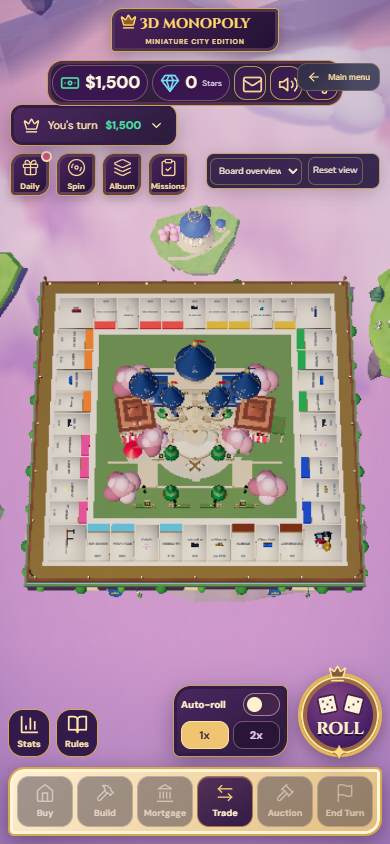 |
| 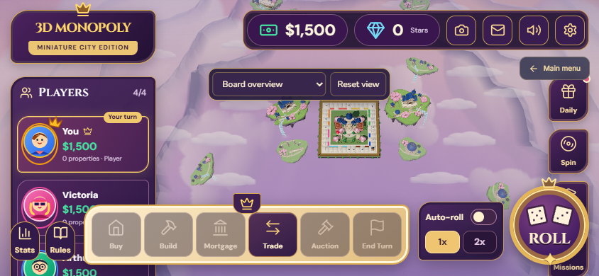 | 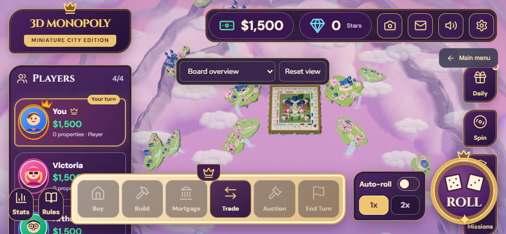 |

The board, central city/castle, HUD, camera controls, presets, gameplay state,
rules, backend and multiplayer code retain their source. The new foundation
sits below the chassis; scenery never intercepts gameplay input or casts board
shadows. Actual exported bounds and browser rays validate tile clearance.

## Blender source and asset inventory

Installed **Blender 5.2.3 LTS** executed
[generate_sunset_kingdom.py](../../tools/blender/generate_sunset_kingdom.py), using
`bpy` and the existing original construction modules. Five assets have three
topology tiers, applied metre-scale Y-up exports, a real
embedded 128×128 atlas, vertex cavity shading and named effect anchors.
Existing GLBs remain byte-for-byte unchanged. All new geometry is original
under the repository MIT license. No paid provider was used. The optional
game-dev CLI is absent; the repository validator inspected the actual bytes.

| Asset | High triangles | Balanced triangles | Low triangles |
| --- | ---: | ---: | ---: |
| crown-foundation | 6,446 | 4,086 | 2,466 |
| royal-garden-dressing | 5,460 | 3,852 | 2,130 |
| royal-island-citadel | 39,450 | 23,888 | 13,136 |
| sky-windmill | 11,448 | 8,406 | 3,956 |
| sky-garden | 11,574 | 7,742 | 4,128 |

[Export hashes, bounds and anchors](../../public/assets/models/environment/sunset-manifest.json) ·
[Binary geometry/texture validation](evidence/asset-validation.json) ·
[Reproduction commands](../../tools/blender/README.md).

Only the selected quality tier is loaded. Background GLBs use a compact
illustrated shader with one sun, sky fill, a small metallic highlight and the
baked cavity colours. The board retains its existing PBR lighting. Model
families share material-batched instancing, with per-placement sphere/frustum
culling. All environment geometry is shadow-free. The cloud volume atlas is
baked once on the CPU; the main sky bakes once on the GPU and on context
restoration. No fullscreen bloom, volume raymarch or fluid simulation is added.
Instance buffers and generated textures are released on scene departure.

## Measured rendering cost

Real Chrome 157 / Three r164 on **AMD Radeon 610M, Direct3D11**. Both builds use
1440×900, DPR 0.9 on low and 1 on balanced/high, seed 10425058, reduced motion,
4-second warmup and 5-second samples per camera. Measurements ran without a
second GPU workload. These are local-browser measurements, not device-wide FPS
guarantees. Counts include the original board, its shadow pass and city.

| Tier / camera | FPS before → after | GPU p50 ms | Draw calls | Triangles drawn |
| --- | ---: | ---: | ---: | ---: |
| low / overview | 70.1 → **88.5** | 13.6 → 10.5 | 1,790 → 1,832 | 179,655 → 207,153 |
| low / reference | 74.6 → **96.3** | 12.5 → 9.2 | 1,808 → 1,861 | 187,603 → 232,075 |
| balanced / overview | 37 → **49.7** | 23.8 → 18.9 | 2,729 → 2,761 | 281,142 → 335,476 |
| balanced / reference | 40.7 → **53** | 21.7 → 17.1 | 2,738 → 2,789 | 283,060 → 376,338 |
| high / overview | 34.5 → **43.9** | 25.9 → 20.8 | 2,729 → 2,761 | 325,596 → 422,406 |
| high / reference | 37.1 → **44** | 24.1 → 20 | 2,748 → 2,799 | 334,087 → 481,247 |

The richer geometry increases download and allocation cost. The simpler
background shader reduces GPU time enough to improve measured FPS in every
case. The original board still accounts for most of the roughly 2,750 draws.

| Tier, lower view | Geometry buffer MiB before → after | Texture allocation estimate MiB | Selected GLB download MiB |
| --- | ---: | ---: | ---: |
| low | 7.2 → 9.3 | 1.1 → 1.7 | 3 → 4.8 |
| balanced | 9 → 13.5 | 2.6 → 3.5 | 4.3 → 7.8 |
| high | 12 → 19 | 5.2 → 6.9 | 6.6 → 11.8 |

Allocation estimates use actual scene buffers and RGBA image dimensions; they
are not driver VRAM readings. [Compact comparison](evidence/performance.json)
and full raw samples under [before](evidence/before/summary.json) and
[after](evidence/after/summary.json) retain the camera, GPU timings, file hashes,
sample counts and material/geometry inventories. Art checkpoint captures are
excluded from the commit.

## Verification

- Production TypeScript/Vite build; local Node 24.21.0 with the existing host
  Rollup WASM shim. CI continues to use the repository's Node 22 configuration.
- 45 presentation, camera, layout, menu boundary and cloud-pixel checks; 16
  online state/lifecycle checks; 10 actual asset and malformed-asset tests.
- Seven matched multi-angle/responsive views, all 40 tile rays clear, same
  cameras and DPR, no asset fallbacks, zero environment shadow casters and no
  browser rendering errors: [view evidence](evidence/after/views.json).
- Real mouse/touch selection of all 40 spaces across four viewport sizes;
  top view, presets, reset, orbit, zoom, dice [1,2], movement to Baltic Avenue,
  purchase for $60 and end turn: [interaction results](evidence/regression/results.json).
- Water/cloud/airship motion, live reduced motion, hidden-tab freeze and no
  diagnostic globals in ordinary play: [motion results](evidence/regression/environment-motion.json).
- Four mount/unmount cycles preserve live allocations and one download per
  cached GLB; an aborted optional asset preserves board selection:
  [resilience](evidence/regression/resilience.json).
- Context loss/restoration at all quality tiers and byte-identical restored
  sky pixels: [context checks](evidence/regression/context-restore.json).

## Limits

The concept has painterly detail and dense flower coverage that this browser
scene approximates with bounded geometry. Clouds use shaded cards plus a
procedural sky bake; architecture uses baked cavity shading and inexpensive
runtime lighting. This is a stylized reconstruction, not an identical render
of the concept. The existing central castle and board illumination remain as
requested. Local Docker was unavailable, so the full PostgreSQL/two-player
browser suite runs in the pull request's existing CI workflow; the local online
state tests passed.

## Reproduce

```sh
blender --background --factory-startup --python-exit-code 1 --python tools/blender/generate_sunset_kingdom.py
npm run test:environment-assets
npm run build
# Serve unchanged main on 4181 and the candidate on 4182.
node scripts/sunset-kingdom-review.mjs before
node scripts/sunset-kingdom-review.mjs after
# Set AUDIT_URL and AUDIT_EVIDENCE_ROOT=docs/sunset-kingdom/evidence as appropriate.
node scripts/atmosphere-audit.mjs before
node scripts/atmosphere-audit.mjs after
node scripts/sunset-kingdom-report.mjs
```
